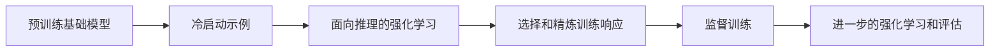

# DeepSeek-R1：推理强化学习与蒸馏

DeepSeek-R1 研究了如何通过强化学习和精心设计的训练阶段来提高面向推理的行为。区分 R1-Zero、完整的 R1 管道和精炼模型：它们是不同的实验和检查点。

## R1-Zero 与 R1 的区别

R1-Zero 将强化学习应用于一个预训练的基础模型，而没有初始的监督冷启动阶段。基于规则的正确性和格式奖励提供了一个验证任务的信号。报告观察到有用的推理行为，但也存在可读性和语言混杂的问题。

完整的 R1 管道添加了冷启动数据、面向推理的强化学习、拒绝采样的监督数据以及进一步训练以实现更广泛的行为。这并不与 R1-Zero 相矛盾；它解决了不同的实际目标。GRPO 提供了组相对策略优化机制，而奖励设计决定了鼓励什么。

## 可验证奖励的价值

对于编程任务，可执行测试可以提供比流畅解释评分更清晰的正确性信号。但通过有限的测试集并不能证明普遍的正确性。奖励利用、不完整的测试和分布偏移仍然可能。将最终答案奖励与所有中间解释都是忠实或有效的声明分开。

## 精炼模型

报告还使用生成和精心设计的推理数据训练了较小的模型。这些学生有自己的基础架构；一个精炼检查点不一定是一个更小稀疏的完整 R1 模型的副本。序列级精炼通过示例传递行为，并且必须独立评估。

## 有用的评估协议

记录确切的检查点、提示模板、采样设置、尝试次数和令牌预算。在相等的推理预算下比较准确性。较长的输出或多个样本可以提高某些评分，但会增加成本；都报告。如果预期的应用需要，则包括非推理任务。

**练习。** 如果一个模型给出了正确的答案但有无效的解释，结果奖励是否必然检测到无效步骤？不一定。过程质量需要额外的评估或监督。

参考：[DeepSeek-R1 报告](https://arxiv.org/abs/2501.12948)。请参阅 [GRPO](../alignment/grpo.md) 和 [精炼](../adaptation/distillation.md)。
