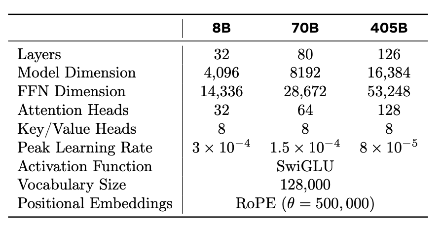
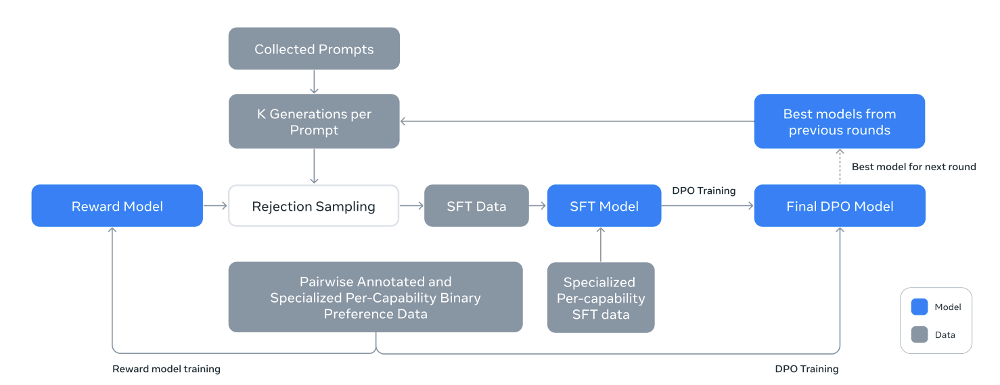
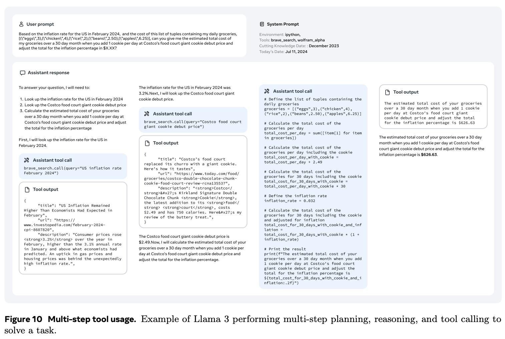
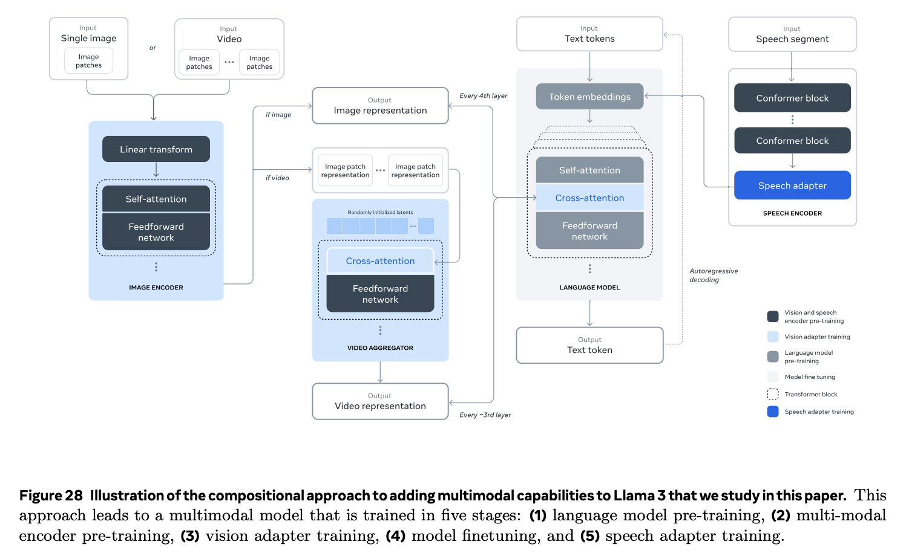

# Llama 3.1 和 Llama 3 技术报告

Llama 3 报告涵盖了文本模型和额外的多模态实验。已发布的 Llama 3.1 文本检查点不应被描述为自动包含报告中探索的所有图像、视频和语音组件。

## 文本架构与后训练

报告中的文本模型使用了带有分组查询注意力的解码器-only Transformer。在查询头之间共享 KV 头可以减少缓存存储；发布的配置使用了八个 KV 头。模型大小通过层数和隐藏维度的变化来调整，因此需要从确切的检查点配置中计算出计算缓存大小。

*架构表将模型大小、注意力头和 KV 头区分开来。它们是内存和计算估计的不同输入。*

后训练迭代数据收集、奖励建模、拒绝采样、SFT 和 DPO。拒绝采样生成候选并选择高得分的响应进行训练。报告中的 DPO 食谱会屏蔽特殊格式化标记，并添加带有系数 0.2 的选定响应 NLL；这些是食谱特定的修改，而不是通用的 DPO 要求。

*后训练图是一个数据和模型迭代循环，而不仅仅是通过一个数据集的一次遍历。*

## 工具使用与部署

*工具使用示例包括结构化的调用、工具结果和最终响应。即使是由模型生成的调用也需要主机端的验证和执行。*

报告还描述了选择性的 FP8 推理选择，包括不量化第一个/最后一个 Transformer 层。这样的结果取决于内核和硬件；“FP8”并不是对每个模型或批次固定加速的保证。

## 多模态实验是独立范围

*视觉实验通过适配器将图像编码器连接到语言。它应该被读作一个实验扩展，而不是每个文本检查点的属性。*

报告分别研究了预训练的图像和语音编码器、模态适配器和视频/语音扩展。训练哪个组件是冻结还是更新是阶段特定的。对于实际使用，请检查命名检查点的模态支持、预处理、上下文配置和模型卡片。

**练习。** 一个仅包含文本的检查点是否因为其技术报告中包含视觉部分而能够读取图像？不。检查点和运行时必须包含并支持视觉路径。

参考：[Llama 3 模型群](https://arxiv.org/abs/2407.21783)。请参阅 [GQA 和缓存计数](../inference/kv-cache.md)。
