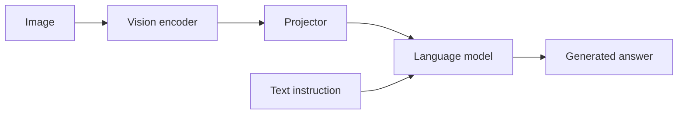

# LLaVA：用连接器完成视觉指令微调

LLaVA将一个预训练的视觉编码器与语言模型连接起来，并训练组合以遵循基于图像的指令。其重要性不仅在于连接架构：视觉指令数据教导了图像证据应如何塑造答案。

## 架构和两个训练阶段

在原始食谱中，CLIP视觉编码器产生视觉特征。一个线性投影器将它们映射到语言模型的隐藏宽度。在特征对齐预训练期间，投影器在冻结视觉编码器和语言模型的同时进行训练。在视觉指令调优期间，投影器和语言模型被更新，而视觉编码器保持冻结。

LLaVA-1.5使用一个两层MLP投影器和其他数据/分辨率改进。这些陈述描述了那些特定的食谱；它们不应泛化到所有后续使用LLaVA名称的模型。

## 这里对对齐意味着什么

匹配向量维度是接口所必需的，但不足以传达语义。训练损失必须教导语言模型如何将投影后的视觉状态与文本输出相关联。对于一张显示两个杯子的图像，“有多少杯子可见？”这个指令提供的任务不同于一个广泛描述的任务。数据多样性对于计数、空间关系、OCR和对话很重要。

一个投影器可以将1024维的视觉状态映射到4096维的语言状态，而无需生成新的视觉证据。增加宽度不会恢复图像调整大小或编码器已经丢弃的细节。

## 评估定位

比较当图像被替换、打乱或移除时的答案。包括语言先验可能建议一个合理的但错误答案的问题。将图像识别错误与指令遵循错误分开，并在部署中使用的精确输入分辨率和预处理下进行评估。

**练习。** 如果一个模型在没有图像的情况下正确回答了一个图像问题，它是否展示了视觉理解？在这个例子中不是。答案可能来自文本捷径或数据集先验知识。

参考文献：[Visual Instruction Tuning](https://arxiv.org/abs/2304.08485)，[Improved Baselines with Visual Instruction Tuning](https://arxiv.org/abs/2310.03744)。比较 [BLIP-2](blip.md) 和 [多模态对齐](../multimodal/alignment.md)。
