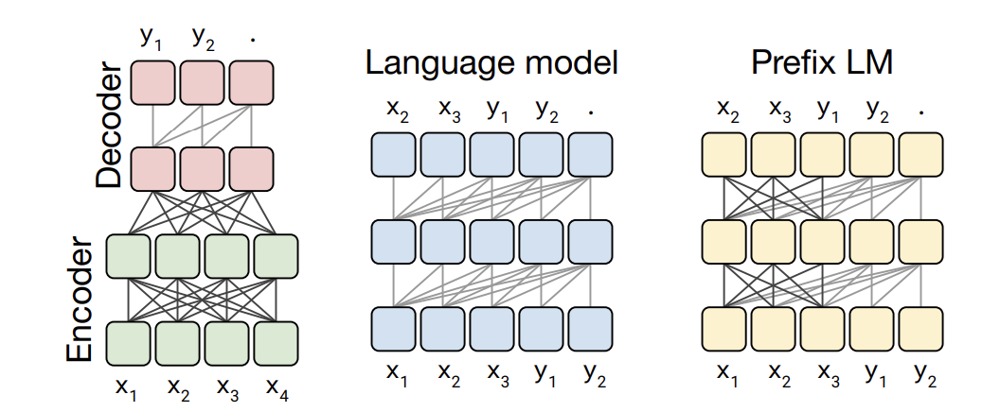
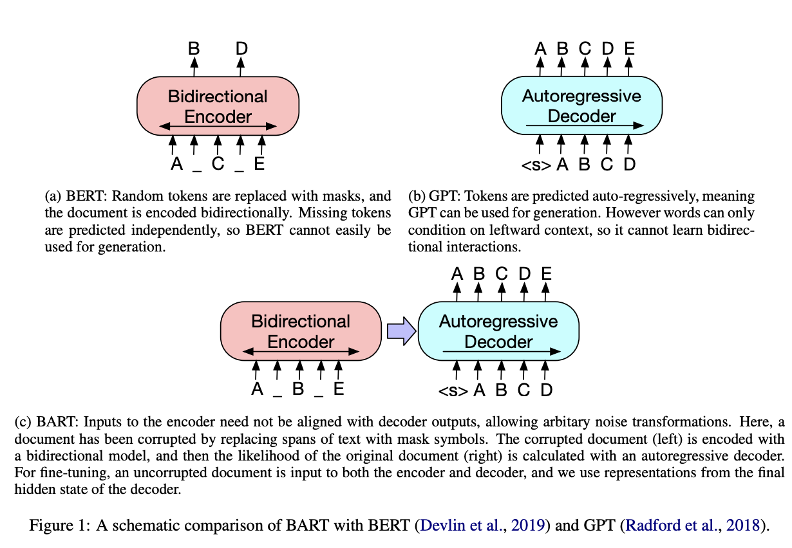
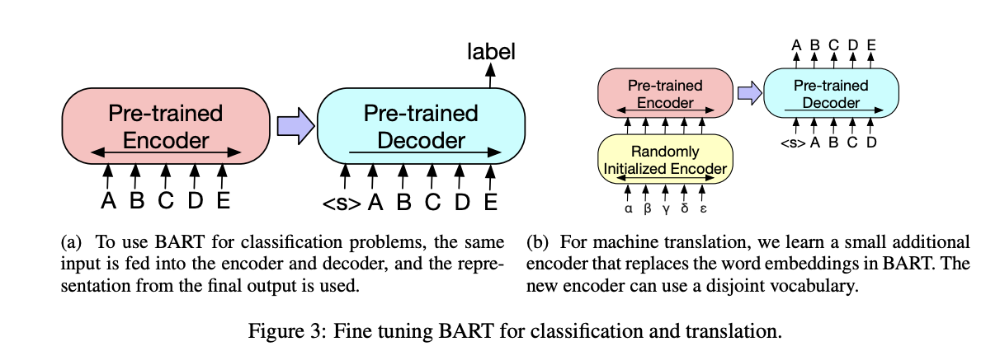

# T5 与 BART：从受损输入学习生成

编码器-解码器模型将输入理解与输出生成分开。编码器双向读取源文本；解码器因果生成目标文本，同时关注编码器状态。T5 和 BART 使用这种结构，但预训练形式不同。

## T5：通用的文本到文本接口

T5 将任务表示为文本输入和文本输出。一个任务前缀，如 `translate English to German:` 描述了操作。分类可以输出标签词；语义相似性可以输出文本评分。CoLA 是一个语法接受性分类任务，而 STS-B 测量句子对的相似度——共享接口并不意味着它们的评估指标相同。

在 span-corruption 预训练中，选定的 span 被不同的哨兵标记替换。目标包含用哨兵分隔的缺失 span。例如，`The <extra_id_0> sat on <extra_id_1>.` 可能需要恢复 `cat` 和 `the mat`。解码器学习条件重构而不是普通地继续可见源文本。

## BART：重建原始文档

BART 损坏文本并学习生成原始序列。论文研究了标记掩蔽、标记删除、文本填充、句子排列和文档旋转。填充用单个遮罩替换一个 span，因此模型必须推断缺失内容及其长度。研究的 span 长度使用均值为 3 的泊松分布。不同的损坏方案创建不同的重构问题；列表不是应用所有方案到每个样本的要求。

**图示说明。** 第一张图片对比了编码器-解码器、因果和前缀可见性。第二张展示了 BART 的损坏输入编码器和自回归解码器，旁边是 BERT 和 GPT。第三张展示了两种微调路径：从学习表示进行分类和序列生成用于翻译。这些插图区分了架构与预训练中使用的输入扰动目标。

## 比较学习信号

| 方面 | T5 | BART |
| --- | --- | --- |
| 任务接口 | 统一的文本到文本公式 | 去噪的序列到序列骨干 |
| 通常的损坏 | 被不同哨兵标记替换的 span | 在选定的食谱中进行填充和句子排列 |
| 重构目标 | 用哨兵分隔的缺失 span | 原始文本 |
| 共享属性 | 双向源编码和自回归目标解码 | 相同 |

对于总结，编码器读取文档，解码器生成较短的文本。两种架构都不保证事实性摘要：一个流畅的解码器可能会引入不支持的细节。分别评估内容覆盖、事实一致性、长度和目标受众。

**练习。** 为什么损坏输入模型可以使用双向注意力而不泄露目标？编码器读取损坏的源；解码器自己的目标流仍然因果掩蔽。

参考文献：[T5](https://arxiv.org/abs/1910.10683)，[BART](https://arxiv.org/abs/1910.13461)。请参阅 [注意力遮罩](../components/attention-masks.md)。
