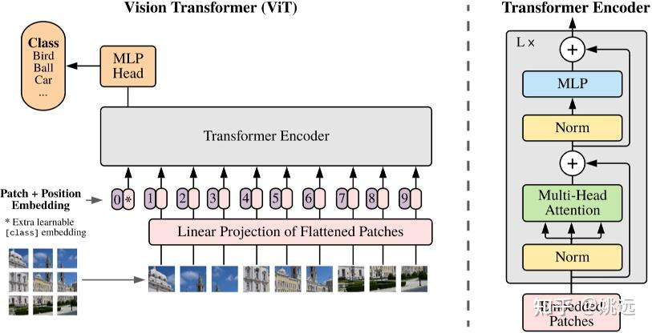

# 视觉 Transformer：把图像转成序列

ViT 使用 Transformer 编码器对图像块进行处理。其起点很简单：如果语言模型可以在标记向量之间混合信息，那么图像模型也可以在表示局部图像区域的向量之间混合信息。

## 图像块嵌入，仔细计算

高度为 $H$、宽度为 $W$、通道数为 $C$ 的图像被分割成 $P \times P$ 个图像块。假设维度可整除，图像块的数量是 $N = HW / P^2$。每个展平的图像块有 $P^2C$ 个值，并被投影到隐藏宽度 $d$。

对于一个 $224 \times 224$ 的 RGB 图像和 $16 \times 16$ 的图像块：

- 有 $14 \times 14 = 196$ 个图像块。
- 每个展平的图像块有 $16 \times 16 \times 3 = 768$ 个值。
- ViT-Base 使用隐藏宽度 768，但这个匹配的数字是一个配置选择。
- 添加一个类别标记后，在编码器之前有 197 个标记。

大小和步长都等于图像块边长的卷积可以实现这种投影。图像块沿序列维度连接，而不是展平成一个巨大的隐藏向量。学习的位置嵌入区分图像块的位置。

**图示说明。** 从下到上阅读图像：图像块被展平并投影成标记，添加了位置信息和类别标记，并且变换器编码器在图像块之间交换信息。分类头读取类别表示。图像块数量控制注意力成本，因此图像分辨率是模型系统设计的一部分。

## 编码器学到什么

自注意力允许一个图像块与第一层中的远距离图像块交换信息。类别标记状态或池化操作提供用于分类的表示。与 CNNs 相比，一个普通的 ViT 内置的局部假设较弱，并且更多地依赖于数据、预训练和增强来学习有用的视觉结构。

## 分辨率是系统决策

将图像块边长从 16 减少到 8（固定图像大小），图像块标记的数量会增加四倍。密集注意力分数大小随后大约增长了十六倍，忽略类别标记。提高分辨率有助于小物体识别或 OCR，但会增加成本。当图像块网格改变时，位置嵌入可能需要插值；验证模型规定的预处理。

**练习题。** 一张 $384 \times 384$ 的图像，图像块边长为 16 像素会产生多少个图像块标记？$24^2 = 576$，或者在类别标记的情况下是 577。隐藏宽度不需要改变。

ViT 特征可以输入 [CLIP](clip.md)、[LLaVA](llava.md) 和其他多模态系统。一个单独的视觉编码器不会生成文本；连接器和文本侧模型定义了那个接口。

参考：[An Image is Worth 16x16 Words](https://arxiv.org/abs/2010.11929).
