!!! info "中文版正在逐篇更新"

    英文优化版已完成。本页暂时保留原笔记，中文版优化正文正在编写。

# Representation Fusion

Learn a joint representation that models cross-modal interactions between individual elements of different modalities

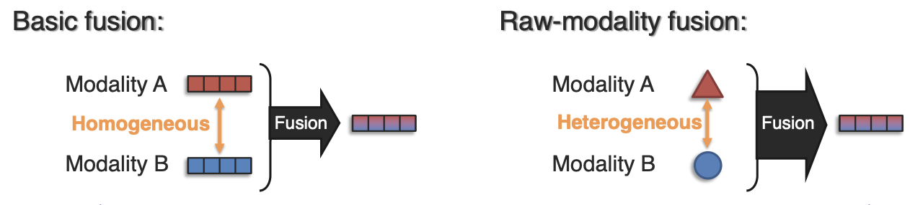

### Early fusion and Late fusion

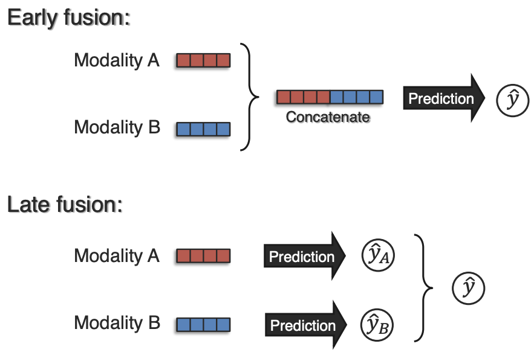

### Linear Regression

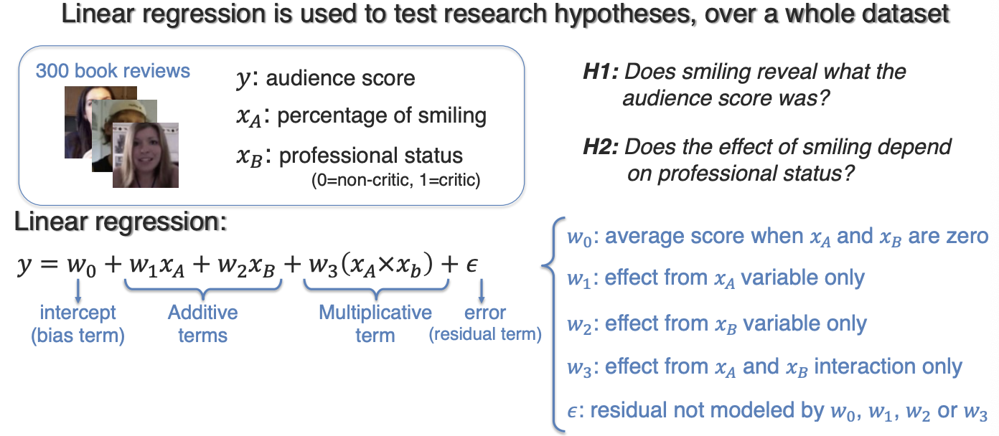

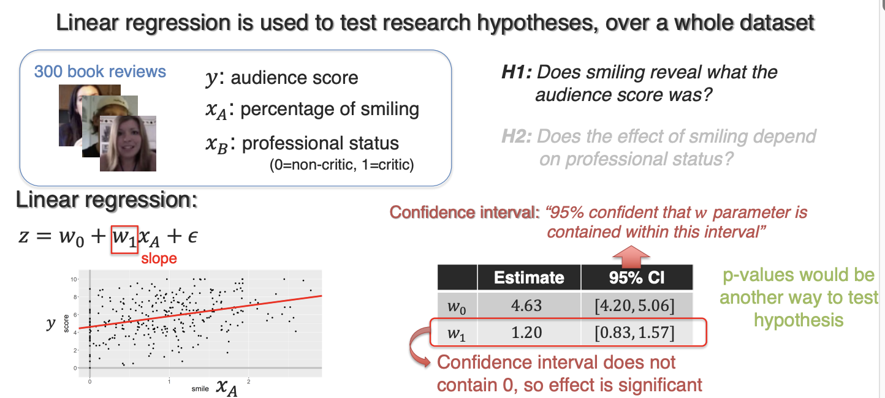

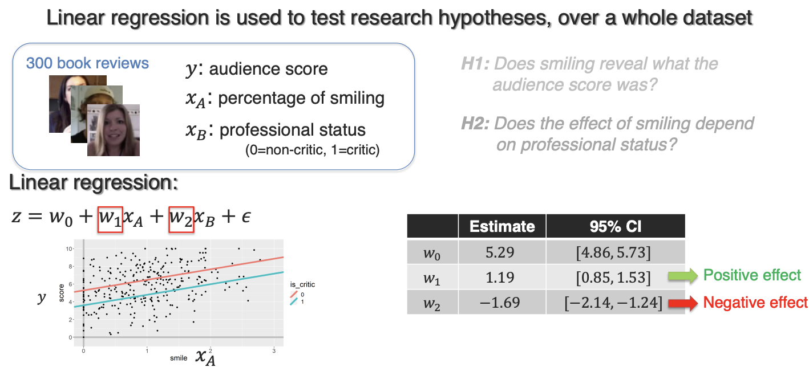

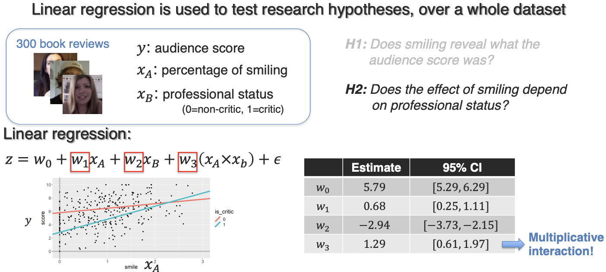

### Additive Fusion

1-layer neural network can be seen as additive (late fusion)

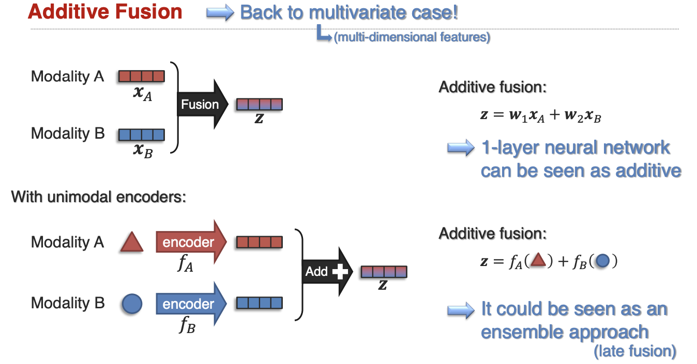

### Multiplicative Fusion

simple and bilinear

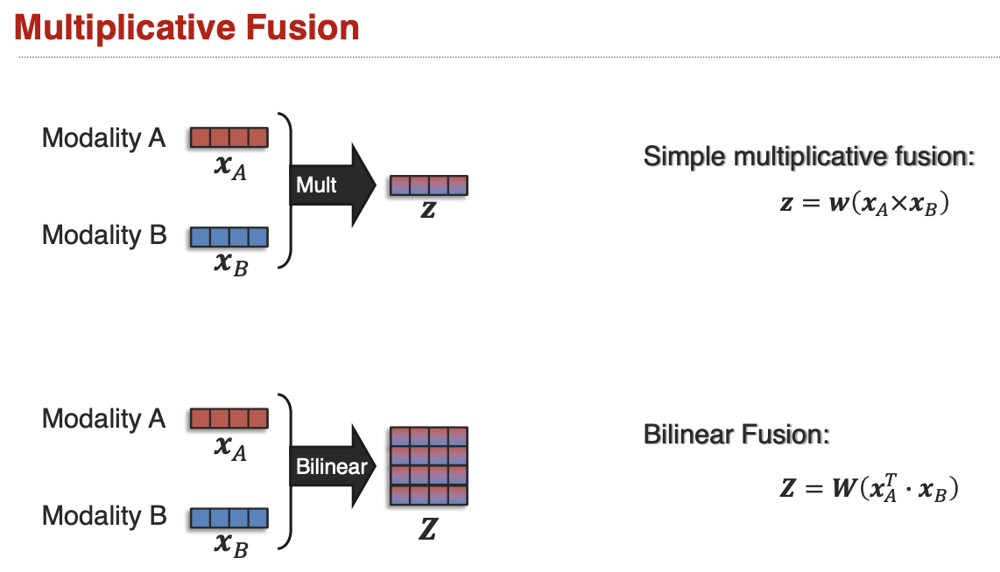

### Tensor Fusion

have unimodal, bimodal, trimodal

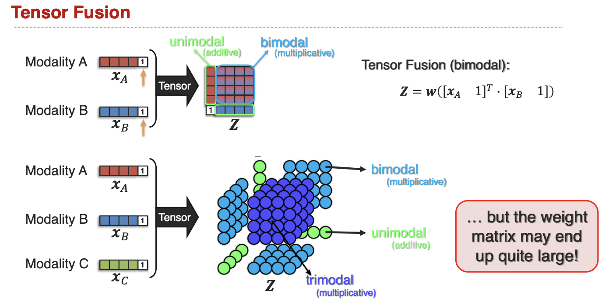

### Low-Rank Fusion

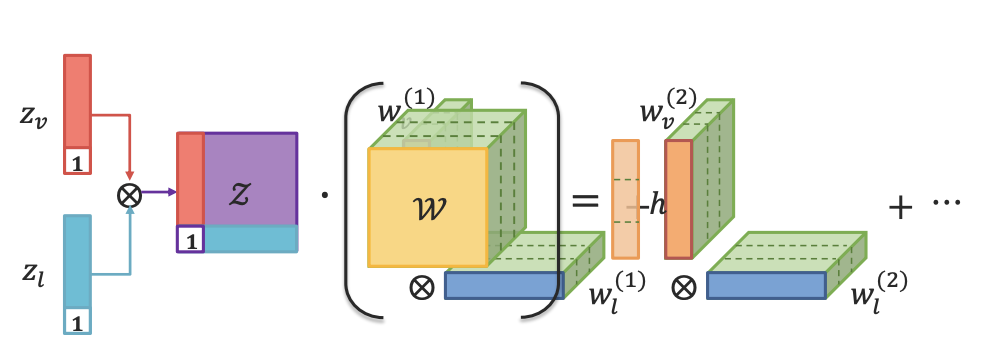

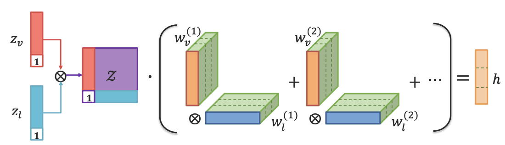

### Tensor vs Low-Rank Fusion

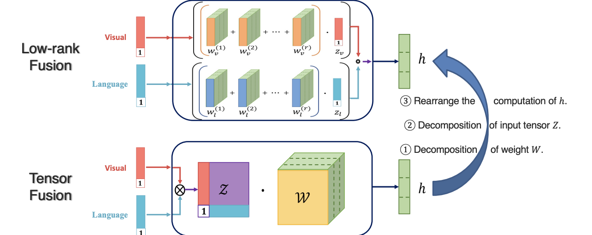

### Gated Fusion

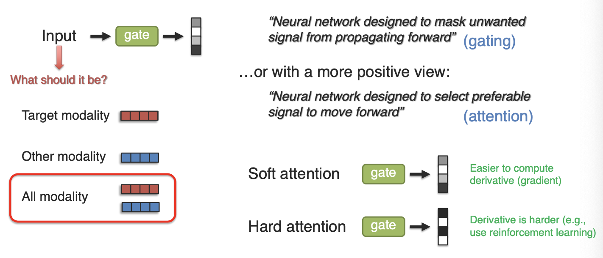

### Modality Shifting Fusion

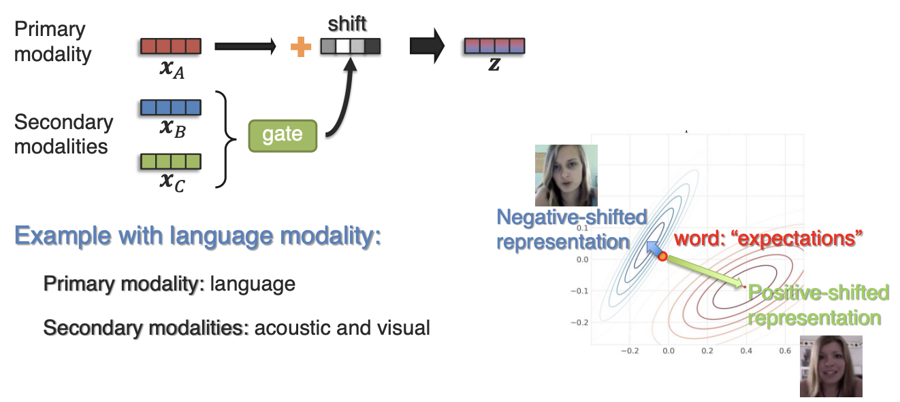

### Non-Additive Interaction

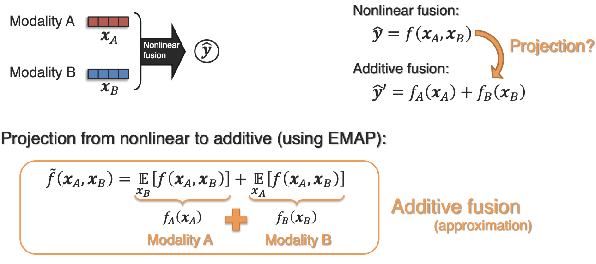

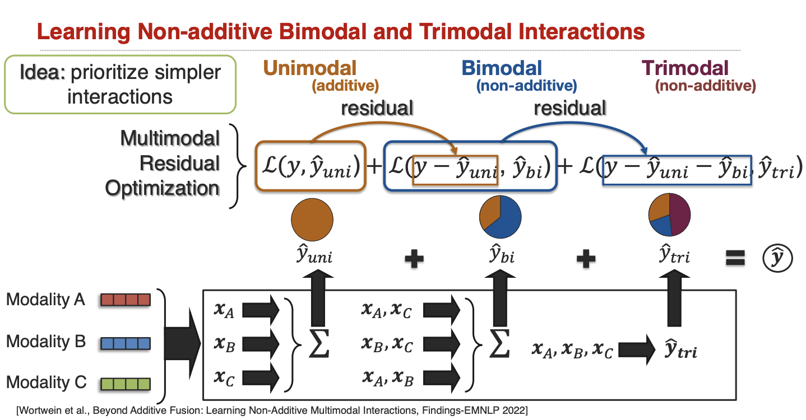

### Heterogeneity-aware Fusion

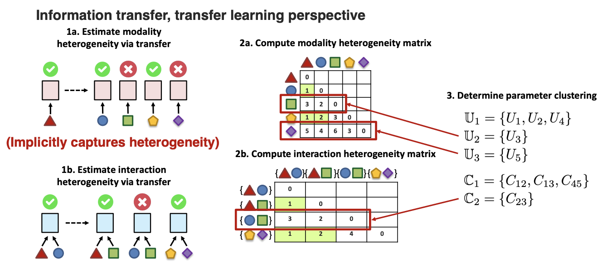

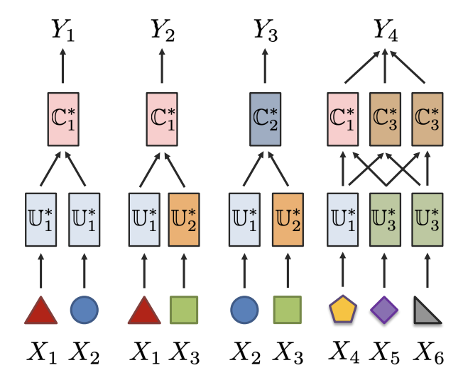

### Improve Optimization

sometimes multimodal doesn’t help!

1. Multimodal networks are more prone to overfitting due to increased complexity
2. Different modalities overfit and generalize at different rates

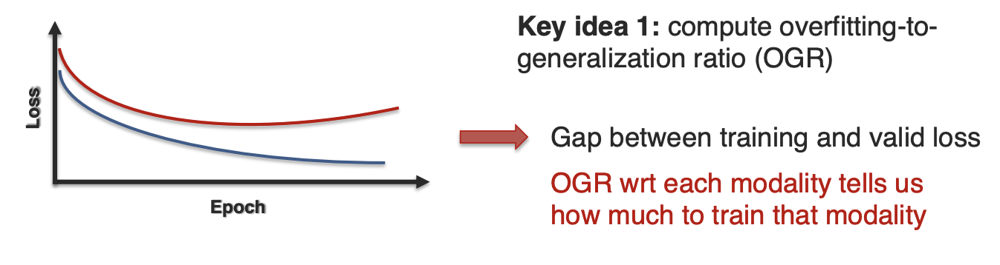

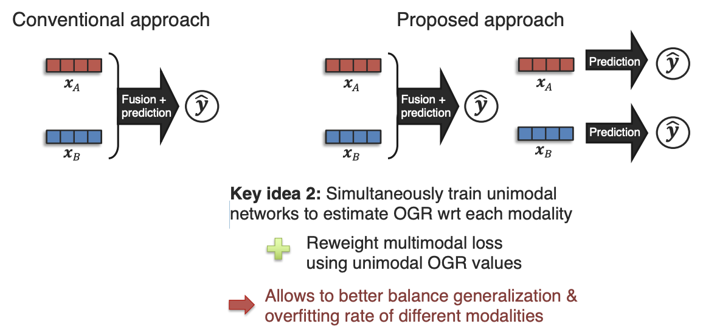
