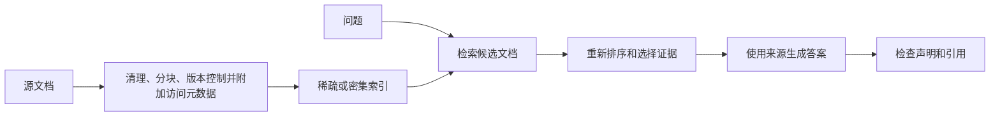

# 🔎 检索增强生成：用证据构建答案

RAG 从外部获取信息并将其提供给生成器。当需要可追溯的、领域特定的或不断变化的证据时，这非常有用。检索增加了对文档的访问权限；它不保证生成器会忠实使用这些信息。

## 🔄 端到端流程

为文档块保留来源标题、URL、时间戳、章节位置、版本与访问权限信息。新内容之外，删除和权限变更也必须同步到索引；文档被索引过，并不等于每个用户都有权查看。

## 🧩 分块与嵌入

在分块时，应保留有用的语义单元，如段落、表格或程序。固定窗口并重叠是基线，而不是普遍适用的400-800标记规则。小块可能会丢失上下文；大块可能会稀释相关性并消耗生成器的预算。提取期间应保留标题和表格意义。

余弦相似度为

$$
\cos(q,d)=\frac{q^\top d}{\|q\|\|d\|}.
$$

对于归一化的向量，点积和余弦相似度相同。使用嵌入模型的预期查询/文档格式和相似性约定。更换嵌入模型通常需要重新计算语料库向量；相等的维度并不意味着兼容的空间。

## 🔎 检索与索引

稀疏方法如 BM25 在精确术语、标识符和罕见符号方面表现强劲。密集检索可以匹配语义同义词，但可能会错过精确的数值区别。混合检索结合候选集或校准排名；原始 BM25 和余弦得分不能自动比较。倒数排名融合是一种无需统一评分尺度即可合并排名的方法。

精确向量搜索提供了一个有用的基线。近似索引如 HNSW 或 IVF 在延迟和内存方面权衡召回率。HNSW 搜索努力和 IVF 探针计数是调优变量，而不是质量保证。使用代表性查询对近似检索进行评估。

查询重写、分解或 HyDE 可以提高召回率，但也可以改变意图或注入虚构术语。一个假设生成的文档是一个检索辅助工具，而不是要引用的证据。

## 🚀 重新排序和上下文组装

跨编码器同时对查询和候选段落打分。它可以改善检索到的候选答案的顺序，但不能恢复从未进入候选池的相关文档。成对的 hinge 目标形式为

$$
L=\max(0,m-s(q,d^+)+s(q,d^-)).
$$

在上下文预算内选择证据，去重近似相同的块，保留有用的来源多样性，并显式处理冲突版本。预留输出标记和指令是预算的一部分。更长的上下文并不总是更好，如果干扰项挤占了决定性证据。

## ✅ 生成与检查

要求答案由提供的段落支持，并将引用附加到它们支持的声明上。验证被引用的段落是否实际上蕴含这些声明。一条“仅使用证据”的指令不会将幻觉或提示注入风险降低为零。检索文本是不可信的内容；它不应该获得改变工具权限或系统行为的权威性。根据模式验证结构化输出，并单独检查语义正确性。

## 📊 评估每个阶段

| 指标 | 定义或用途 |
| --- | --- |
| 召回率@k | 相关文档被检索到的数量除以所有标记的相关文档数量 |
| 命中率@k | 至少有一个相关文档出现在前 k 个中 |
| 精确率@k | 相关结果除以 k |
| MRR | 第一个相关结果的倒序排名平均值；当不存在时为零 |
| nDCG | 带有等级相关性和位置折扣的排名质量 |
| 忠实性 | 生成的声明是否由证据支持 |

如果存在三个相关文档，而前五个包含两个，则 Recall@5 是 $2/3$，Precision@5 是 $2/5$，Hit@5 是 1。这些不是可互换的定义。

**练习。** 检索召回率高但答案错误。接下来该怎么办？在替换嵌入模型之前，请检查重新排序、证据截断、矛盾来源和生成/引用行为。

参考文献：[原始 RAG 表述](https://arxiv.org/abs/2005.11401)，[密集段落检索](https://arxiv.org/abs/2004.04906)，[HyDE](https://arxiv.org/abs/2212.10496)。继续进行 [RAG 课程实验室](courses/llm/rag.md)。
