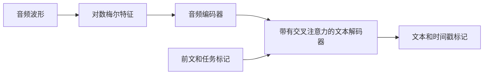

# Whisper：语音识别作为条件序列生成

Whisper 使用编码器-解码器 Transformer 从音频中生成文本。原始工作研究了跨语言和任务的大型弱监督。其鲁棒性是基于评估数据的经验结果，而不是对每种口音、录音条件或词汇表的保证。

## 音频到文本

音频被转换为对感知频率尺度有动机的对数梅尔频谱图（log-Mel spectrogram），它表示时间变化的能量。编码器将这些特征转换为音频状态。解码器使用因果自注意力处理前文和跨注意力到音频状态，然后预测下一个标记。

原始模型使用80个梅尔通道；后来的检查点，如large-v3，使用不同的特征配置。匹配预处理到检查点。多语言分词器在字节级BPE方法的基础上扩展了语言、任务和时间戳标记；仅限英语和多语言配置有所不同。

## 任务标记和时间戳

控制标记区分转录和翻译。在原始的多语言设置中，翻译意味着语音到英语，而不是任意目标语言的翻译。时间戳标记指示时间位置，但准确的单词级对齐可能需要额外的处理和评估。

原始论文报告了在680,000小时的多语言/多任务音频监督上进行训练。规模和多样性提高了泛化能力，而弱标签仍然可能包含错误。静音、音乐、重叠语音或不熟悉的术语可能导致遗漏或幻觉文本。

## 实际评估

使用代表性录音、参考转录和明确的归一化政策。测量[WER/CER](asr.md)，如果需要则测量时间戳准确性，延迟以及重要词项上的错误率。检查仅静音和噪声段。分块长录音引入了边界/上下文选择，可能会影响重复或缺失的单词。

**练习。** 如果在两个转录中去除标点符号后WER提高，那么基础识别器是否必然改进？不一定。评估归一化发生了变化。要进行同类比较。

参考：[Whisper论文](https://arxiv.org/abs/2212.04356)，[官方实现和检查点详细信息](https://github.com/openai/whisper)。
