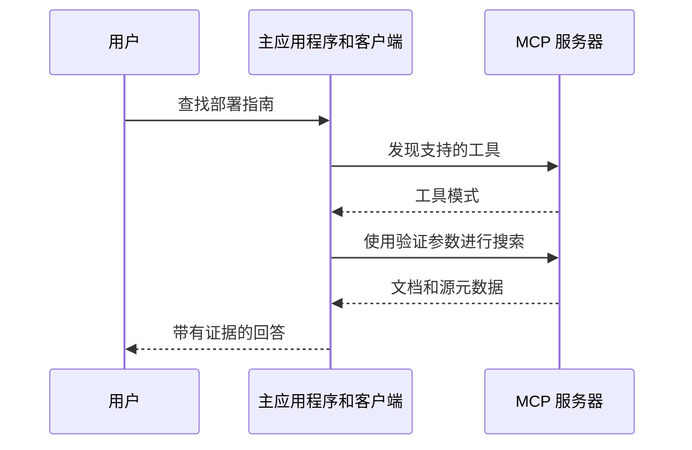

# MCP：连接 AI 应用与工具的协议

Model Context Protocol 标准化了AI应用程序与外部能力和上下文的通信方式。它是一个集成协议，而不是语言模型、训练方法或保证某个模型会选择正确的工具。

## 参与者及职责

主应用程序包含面向模型的体验并管理权限和连接。MCP客户端与服务器通信。服务器根据协商的协议版本暴露诸如工具、资源和提示等能力。传输和生命周期细节是版本化的；请使用匹配的SDK/规范文档。

| 原语 | 用途 | 示例 |
| --- | --- | --- |
| 工具 | 执行结构化操作 | 搜索文档索引 |
| 资源 | 提供可寻址的上下文 | 读取仓库指南 |
| 提示 | 提供可重用的交互模板 | 结构化的审查工作流 |

主应用程序决定什么成为模型上下文以及如何授权操作。服务器的描述本身不是用户执行某个动作的权限。

## 跟随文档搜索请求

应用程序发现搜索工具的名称和输入模式。模型提出诸如查询字符串等参数。主应用程序验证并分派调用。服务器返回结构化结果，应用程序可以将这些结果提供给模型以带有引用来回答问题。

## 实现必须正确处理的内容

在服务器边界处验证输入，强制实际调用者的访问权限，并区分读操作和变更。显式处理超时和部分失败。重试读取与重试支付或消息发送不同；变更工具需要适当的幂等性语义。将检索到的文档文本视为数据而不是覆盖主应用程序规则的指令。

这些是应用程序设计要求，不是由JSON模式自动提供的功能。一个工具可能接受语法上有效的参数，但仍需进行语义检查。

**练习。** 如果列出了一个工具，这意味着每个用户是否可以在每个资源上调用它？不。发现、认证、授权和用户意图是不同的检查。

参考：[MCP架构和版本化文档](https://modelcontextprotocol.io/docs/learn/architecture)。比较 [LangChain](langchain.md)，它有助于在这些集成之上协调应用程序行为。
