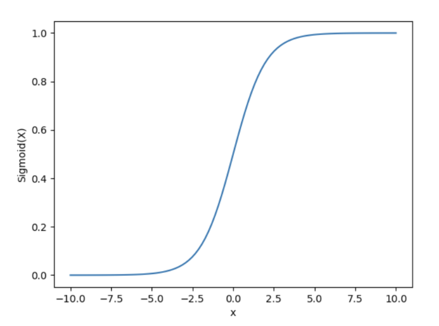
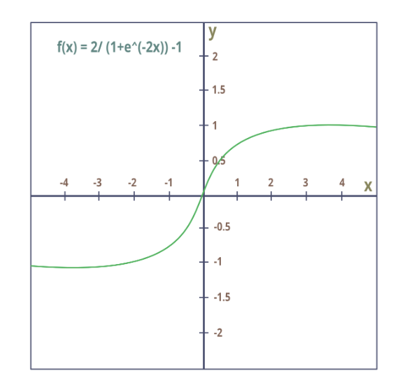
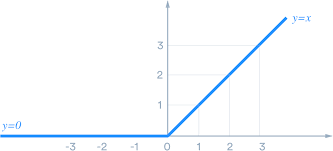
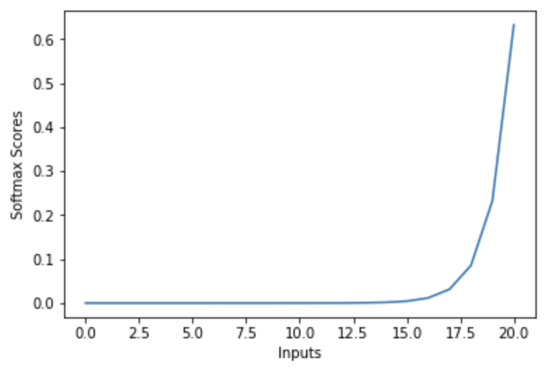
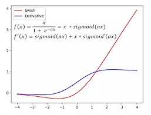

# 激活函数：为什么深度网络需要非线性

只堆叠线性层，不会得到更丰富的深层函数族：$W_2(W_1x+b_1)+b_2$ 仍然是一次仿射变换。激活函数打破这种合并，决定信号和梯度如何穿过网络；输出端的激活函数还表达对预测目标的假设。

## 主要函数及其作用

| 函数 | 定义 | 理解方式 |
| --- | --- | --- |
| Sigmoid | $1/(1+e^{-x})$ | 将分数映射为二分类概率 |
| Tanh | $(e^x-e^{-x})/(e^x+e^{-x})$ | 有界、以零为中心的隐层信号 |
| ReLU | $\max(0,x)$ | 保留正输入，阻断负输入 |
| SiLU / $\beta=1$ 的 Swish | $x\sigma(x)$ | 平滑、依赖输入的门控 |
| Softmax | $e^{z_i}/\sum_j e^{z_j}$ | 对互斥选项建立概率分布 |

原笔记中的“SWISS”指 **Swish/SiLU**。SiLU 是一般形式 $x\sigma(\beta x)$ 在 $\beta=1$ 时的特例。平滑不代表总是更好，激活、初始化、归一化和架构会相互影响。

## 沿着梯度理解

Sigmoid 导数是 $\sigma(x)(1-\sigma(x))$，最大为 $1/4$，输入绝对值很大时接近零。反复乘以较小导数，会削弱深层梯度。Tanh 在两端也会饱和。

ReLU 在正半轴导数为 1，负半轴为 0；原点不可微，具体实现会选择约定。如果一个单元对所有相关输入始终为负，这条路径就可能不再收到有效梯度。Leaky ReLU 保留较小的负半轴斜率，SiLU 使用平滑门控，但它们都不能消除所有优化问题。

## 例子：稳定计算 Softmax

Logits 为 `[1000, 1001, 1002]` 时，直接计算指数可能溢出。先减去最大值不会改变 Softmax，因为公共指数因子会抵消。

```python
# runnable-example
from math import exp
z = [1000, 1001, 1002]
a = [exp(v - max(z)) for v in z]
p = [v / sum(a) for v in a]
assert abs(sum(p) - 1) < 1e-12
assert abs(p[2] - 0.6652409558) < 1e-9
```

给所有 Logit 加同一个常数，概率不变；乘同一个正数会改变分布尖锐程度，相当于改变温度。



Sigmoid 两端接近平坦，中间区域最敏感。



Tanh 以零为中心，但仍然饱和；零中心输出不能自动避免梯度消失。



ReLU 保留正半轴、将负半轴置零，这同时解释了简单梯度与失活单元问题。



这张原 Softmax 图表示某个选定分数向量对应的概率。Softmax 是向量归一化，不是独立的标量函数曲线：任意竞争项的 Logit 改变，也会影响其他概率。



原 Swish 图还展示了导数。SiLU 的导数为 $f'(x)=\sigma(x)+x\sigma(x)(1-\sigma(x))$。一般形式 $x\sigma(\beta x)$ 的第二项还要乘 $\beta$，抄写导数前应确认参数约定。

## 输出与任务要匹配

“有人”和“有自行车”可以同时成立，适合独立 Sigmoid；建模选项中只能有一个类别时，适合 Softmax。连续回归通常不需要有界输出激活，无依据地限制输出范围可能阻止合法预测。

损失函数如果要求 Logits，就传 Logits。在融合交叉熵实现之前先做 Softmax，可能扭曲优化并损失数值稳定性。激活输出落在概率范围内，也不自动保证概率校准。

## 进阶

GELU 用高斯累积分布概率对输入加权，常用于 Transformer 前馈层。SwiGLU 等门控变体，用非线性分支乘另一个学习到的投影。它们同时改变表达能力和参数量，比较时应控制算力和宽度。

**练习：**为什么两层纯线性模型学不了 XOR？**答案：**组合后仍为仿射变换，而 XOR 需要非线性分隔。隐层非线性允许不同输入区域接受不同处理。

继续阅读[损失函数](loss-functions.md)、[归一化](../llm/components/normalization.md)和[训练诊断](training-challenges.md)。资料：[PyTorch SiLU](https://docs.pytorch.org/docs/stable/generated/torch.nn.SiLU.html)、[GELU 论文](https://arxiv.org/abs/1606.08415)、[GLU 变体](https://arxiv.org/abs/2002.05202)。
