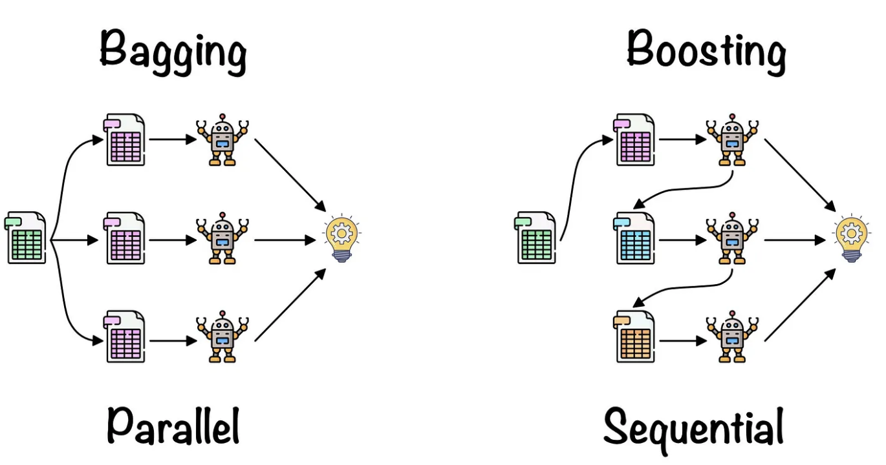

# Bagging 与 Boosting：组合模型的两种思路

集成学习把多个预测器组合起来，但预测器之间的训练关系十分关键。Bagging 在扰动后的数据集上分别训练模型，再聚合结果。Boosting 按顺序构建加法模型，让每个新组件改善当前目标。

## Bagging：让不稳定的学习器更稳定

Bootstrap 从大小为 $n$ 的数据集中有放回地抽取 $n$ 个样本。每份抽样数据训练一个基学习器，再聚合预测。单棵树可能变化很大，多棵树的平均结果却可以更稳定。

假设 $B$ 个预测具有相同方差 $\sigma^2$，两两相关系数为 $\rho$，简化后的平均预测方差为

$$
\operatorname{Var}(\bar f)=\sigma^2\left(\rho+\frac{1-\rho}{B}\right).
$$

增加模型能减小方差中相互独立的部分，却无法平均掉共同错误。这解释了多样性的重要性，也解释了为什么复制同一个已训练模型一百次没有帮助。

## Boosting：学习下一次有用的修正

加法模型写作 $F_M(x)=F_0(x)+\sum_{m=1}^M\eta h_m(x)$。梯度提升选择 $h_m$，使它近似函数空间中有用的更新方向，通常是当前预测处损失函数的负梯度。

AdaBoost 通过更新权重强调被错分的样本，但这并不是所有 Boosting 的定义。平方误差梯度提升拟合残差，其他损失则对应其他梯度目标。

箭头区分独立训练的 Bootstrap 模型与逐步修正的模型。“并行”描述训练依赖，实际耗时仍取决于硬件、树的数量和实现。

读图时关注模型之间的箭头：Bagging 的各分支可以独立训练，最后汇总；Boosting 的后续阶段依赖前面阶段形成的预测与误差。图中的“并行”和“串行”描述的是阶段依赖，不能直接等同于实际运行速度。

## 对比例子

三棵回归树对同一输入预测 8、10、12。Bagging 平均后得到 10；其中任何一棵都不是专门为修复前一棵的错误而训练的。

Boosting 则可能从 8 开始，拟合出修正量 4，但只加入 $0.25\times4=1$，使预测变成 9。下一棵树针对更新后的模型训练。每棵树的贡献并不是对最终目标的独立预测。

| 问题 | Bagging | Boosting |
| --- | --- | --- |
| 基模型能否独立训练？ | 通常可以 | 后续阶段依赖前面阶段 |
| 核心直觉 | 用平均降低不稳定性 | 逐步改善加法模型目标 |
| 常见控制项 | 模型数、采样、基模型复杂度 | 阶段数、学习率、树复杂度 |
| 典型风险 | 相关错误依然存在 | 过多、过激的修正拟合噪声 |

## 进阶理解

Bagging 常能降低深树等不稳定学习器的方差，但对本来就稳定的学习器帮助未必大。Boosting 可以降低逼近误差，也可能过拟合，结果取决于数据、基学习器和正则化。不存在无条件更好的方法。

在一次 Boosting 阶段内部并行计算特征和分裂，并不能消除阶段之间的依赖。反过来，即使 Bagging 训练容易并行，大型集成的推理延迟也可能很高。

评估时应使用相同的数据划分和资源预算，比较完整流水线。拿一千棵深树和十棵浅树比较，无法单独检验集成原理的优劣。

**思考：**随机森林为什么在 Bootstrap 之外再引入特征随机性？**答案：**降低树之间的相关性，让平均更加有效。

接着阅读[随机森林](random-forests.md)和[梯度提升](gradient-boosting.md)。

## 来源与延伸阅读

- [scikit-learn：集成方法](https://scikit-learn.org/stable/modules/ensemble.html)：区分 Bagging、森林、AdaBoost 和梯度提升。
- [Friedman：Greedy Function Approximation](https://projecteuclid.org/journals/annals-of-statistics/volume-29/issue-5/Greedy-function-approximation-A-gradient-boosting-machine/10.1214/aos/1013203451.full)：梯度提升的推导。
