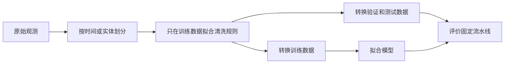

# 数据清洗：保护实验结论

数据清洗把观测转换为可信的模型输入。目标不只是让每一列看起来整齐，而是在保留观测含义的同时，防止模型意外使用预测时无法获得的信息。

**前提：**明确一行代表什么，以及要预测什么结果。如果这两点不清楚，清洗规则只能靠猜。

## 从数据约定开始

记录观测单位、标识符、时间戳、特征单位、合法范围和目标定义。例如每日需求预测中，缺货时“销售量”和“需求量”并不相同。缺失值可能表示“未测量”“不适用”或“系统故障”，这些机制不应该自动使用同一种填补方式。

在实体层面检查重复。数值完全相同的两行可能是真实的重复测量；同一笔交易的不同记录也可能是重复更新。没有关键标识就去重，会误删真实观测。

## 先划分，再学习清洗规则

中位数、标准化均值、词表、主成分和特征筛选阈值等统计量，都必须只在训练部分拟合。验证和测试部分只应用已拟合规则。交叉验证时，每一折都要重新拟合整条处理流水线。



对每个特征都问：**做出预测的那个时刻，这个值已经存在吗？**即使退款时间戳完整、类型正确，它也不能用于预测刚下单的订单未来会不会退款。

## 例子：缺失年龄

训练年龄为 `[20, 30, None, 80]`，验证年龄为 `[None, 1000]`。训练中位数是 30，因此验证集的缺失值也用 30 填补，而不是在验证集上重新计算中位数。1000 需要触发有记录的范围检查，不能悄悄进入填补统计量。

```python
# runnable-example
from statistics import median
train = [20, 30, None, 80]
fill = median(x for x in train if x is not None)
valid = [None, 1000]
invalid = [x is not None and not 0 <= x <= 120 for x in valid]
assert fill == 30
assert invalid == [False, True]
```

缺失指示变量可以保留信息，但也可能编码一种部署后会变化的采集流程。应检验这两种可能，而不是默认缺失本身具有稳定预测能力。

## 类别不平衡也是建模问题

不要为了让准确率好看而“平衡”最终测试集。应保留部署人群的分布，或者明确报告估计对应的人群。使用合适的精确率—召回率或成本敏感指标，比较类别权重、阈值和采样策略。

SMOTE 在特征空间内插生成样本，未编码类别、稀疏文本、时间序列或存在组合约束的数据可能不适合它。任何重采样都必须位于**划分后的训练折内部**，否则合成样本可能把信息泄漏到其他折。

## 进阶：让清洗过程可观察

对规则进行版本管理，监控被拒绝行比例、各来源的缺失率、类别变化，以及使用回退值的预测比例。如果模型只有在丢弃难处理的线上样本后才表现良好，评价是不完整的。

**练习：**表中有一个利用全量数据计算的“用户最后购买日期”，能用于预测上个月是否购买吗？**答案：**只有在每个历史预测时刻，都仅使用当时已知信息重新计算，才有效。

继续阅读[过拟合与泄漏](overfitting.md)、[评价指标](metrics.md)和 [Pandas](../pandas.md)。

资料：[scikit-learn 常见陷阱](https://scikit-learn.org/stable/common_pitfalls.html)说明泄漏与流水线隔离；[imbalanced-learn 重采样泄漏](https://imbalanced-learn.org/stable/common_pitfalls.html)展示错误评价方式。
