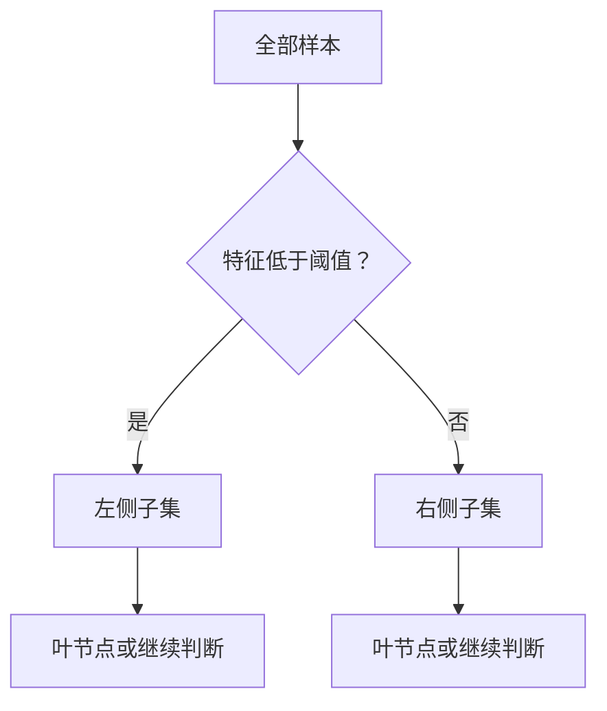

# 决策树：用一连串问题划分特征空间

决策树沿着一系列特征判断给出预测。内部节点提出“温度是否低于 18 度”这样的问题，叶节点保存最终预测。存在阈值和特征交互时，树很有用；从根到叶的路径也提供了说明单次决策的具体方式。

## 怎样选择分裂

训练会搜索候选特征和阈值，寻找能降低节点不纯度的划分。对于类别比例 $p_k$，常用指标包括基尼不纯度 $1-\sum_kp_k^2$ 和熵 $-\sum_kp_k\log_2p_k$。只包含一个类别的纯节点，不纯度为零。

父节点为 $P$、子节点为 $L,R$ 时，不纯度下降为

$$
\Delta I=I(P)-\frac{n_L}{n_P}I(L)-\frac{n_R}{n_P}I(R).
$$

权重是**子节点样本数除以父节点样本数**。使用样本权重时，所有计数都应一致地替换为加权计数。把分数颠倒，就失去了“分裂后平均剩余不纯度”的含义。

回归树通常最小化叶节点内部的预测平方误差，并以叶内目标均值作为预测。使用其他准则时，叶节点的估计方式也可能不同。

## 算例

父节点有 6 个正例、4 个负例，基尼不纯度是 $1-0.6^2-0.4^2=0.48$。某次划分让左子节点包含 4 个正例、0 个负例，右子节点包含 2 个正例、4 个负例。子节点的加权不纯度为 $(4/10)0+(6/10)(4/9)=0.2667$，下降约 0.2133。

```python
# runnable-example
def gini(counts):
    n = sum(counts)
    return 1 - sum((c / n) ** 2 for c in counts)
gain = gini([6, 4]) - 0.4 * gini([4, 0]) - 0.6 * gini([2, 4])
assert abs(gain - 0.2133333333333333) < 1e-12
```

这次局部改进不代表整棵树达到全局最优。贪心训练只是连续选择当前看来有利的划分。

## 为什么会过拟合

很深的树能隔离极小的样本群，甚至单个样本，用非常具体的规则拟合噪声。应通过验证集选择最大深度、叶节点最小样本数或剪枝强度。数据的小幅变化可能改变早期分裂，继而改变树的大部分结构。



## 进阶理解

沿坐标轴划分会形成矩形区域。面对斜向决策边界，树可能需要很多叶节点。数值特征的单调缩放通常保留候选值顺序，所以标准化不像距离模型中那样关键。缺失值和类别特征的处理取决于实现，不能假设所有树库都一样。

基于不纯度的特征重要性可能偏爱候选切分点很多的特征。相关特征可能分摊或替代彼此的重要性。可以在留出数据上使用置换分析，同时考虑相关性；预测重要性不等于因果关系。

**练习：**为什么训练准确率 100% 的树可能不如深度为 3 的树？**答案：**它可能用细碎划分记住了样本噪声。应比较留出数据上的效果及其不确定性。

接着阅读[随机森林](random-forests.md)、[梯度提升](gradient-boosting.md)和 [Bagging 与 Boosting](bagging-boosting.md)。

## 来源与延伸阅读

- [scikit-learn：决策树](https://scikit-learn.org/stable/modules/tree.html)：划分准则、剪枝和实现限制。
- [scikit-learn：置换重要性](https://scikit-learn.org/stable/modules/permutation_importance.html)：另一种模型检查方法。
