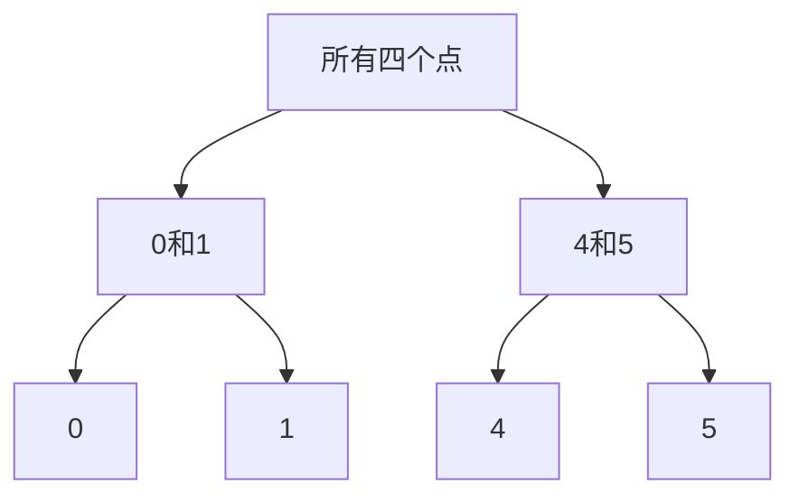

# 🗂️ 层次聚类：从不同尺度观察分组

层次聚类创建了一个嵌套的组家族，而不是只返回一个平面分区。谱系图记录了簇合并的时间。在选定的级别上切割这棵树会生成一个分区，但树的形状强烈取决于距离和链接规则。

## 🧭 聚合和分裂方法

聚合聚类从单个观测值开始，并反复合并簇。分裂方法则从一个大群组开始并将其拆分。在聚合方法中，“合并最接近的簇”不完整，直到你定义了两个点集之间的距离。

| 链接 | 距离或标准 | 特征行为 |
| --- | --- | --- |
| 单一 | 不同簇中最接近的一对 | 可以通过一条细链连接组群 |
| 完整 | 最远的一对 | 倾向于紧凑的直径；对极端对敏感 |
| 平均 | 跨簇平均距离 | 在对之间平衡 |
| Ward | 内部簇平方误差增加 | 方差基于；通常需要欧几里得几何 |

Ward链接不仅仅是另一种计算成对距离平均值的方式。它遵循一个特定的方差最小化标准。

## 🧩 实例分析

对于点 `[0, 1, 4, 5]`，最近的合并创建了 `{0,1}` 和 `{4,5}`。在这两个簇之间，单一链接距离为3，完全链接距离为5，平均链接距离为 $(4+5+3+4)/4=4$。

因此，相同的观测值在不同的链接下会产生不同的合并高度。高度不是概率，一个高间隔并不自动证明存在自然的类边界。

此图表显示了嵌套的成员关系，而不是定量缩放的谱系图。在绘制的谱系图中，合并高度携带距离信息。

## 🔍 仔细阅读结果

叶子顺序可以在不改变层次结构的情况下发生变化。绘图中的相邻叶子不一定是最接近的一对，除非合并结构说明如此。平面聚类需要一个切分规则，如目标组数或距离阈值，并且这些选择应与使用情况相关联。

特征缩放会改变距离。缺失值处理和无关维度的包含也会这样做。从不良表示计算出的层次结构可能在视觉上令人信服，但对用户无帮助。

## 🚀 进一步探索

聚合决策通常不可逆：早期合并不会在全球范围内重新考虑。这使得噪声、链式反应和局部模糊变得重要。比较重采样下的稳定性并检查提议组的代表性成员。

许多实现随着样本数量的增长需要大量的成对距离计算或内存。连接性约束可以限制可接受的合并，并编码局部结构，但它们也会改变聚类问题。如果图是不连通的，请检查实现如何处理它。

**练习：** 如果一个异常值远离所有其他点，哪个链接特别受其最大距离的影响？**答案：** 完整链接直接使用最远的跨簇对。Ward也可以通过平方距离敏感；确切的结果取决于簇大小和几何形状。

继续阅读 [DBSCAN](dbscan.md)，[K-means](kmeans.md) 和 [距离保持嵌入](isomap.md)。

## 📚 参考来源和进一步阅读

- [SciPy：层次链接](https://docs.scipy.org/doc/scipy/reference/generated/scipy.cluster.hierarchy.linkage.html) 提供了确切的链接定义。
- [scikit-learn：层次聚类](https://scikit-learn.org/stable/modules/clustering.html#hierarchical-clustering) 描述了连接性约束。
