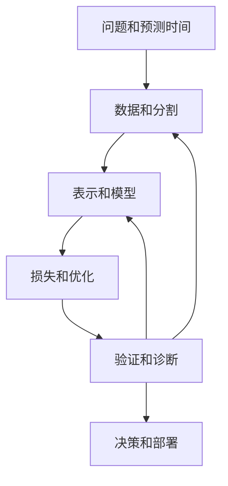

# 📐 机器学习基础：建立可解释、可评估的模型

本节开发了将观察转化为可靠预测所需的工具。你不需要在开始前记住每一个算法。学会如何将问题变成数据集，如何将目标变成更新，以及如何即使代码运行正确，评估也可能失败。

## 🧭 初学者路线

从[学习范式](learning-paradigms.md)开始，然后定义一行和一个预测目标。在训练之前阅读[数据清洗](data-cleaning.md)：一个泄漏的时间戳可能比模型家族更重要。使用[线性和逻辑回归](linear-logistic.md)作为透明的基线，并在学习[指标](metrics.md)的同时学习[损失函数](loss-functions.md)。

一个有用的初学者项目是针对小表格数据集进行二分类。建立训练/验证/测试分割，仅对训练数据拟合预处理，比较基线与树，并在选定的阈值下解释混淆矩阵。交付的是一个可理解的实验，而不仅仅是高分。

## 🧩 概念地图

反馈箭头代表受控实验。它们不是重复调整到最后测试集的许可。

## 🏗️ 选择一个模型家族的理由

| 情况 | 从这里开始 | 主要问题 |
| --- | --- | --- |
| 可解释的线性基线 | [线性/逻辑模型](linear-logistic.md) | 表示是否足够？ |
| 非线性表格交互 | [树](decision-trees.md)，[森林](random-forests.md)，[提升](gradient-boosting.md) | 复杂度在泛化中有多重要？ |
| 基于相似性的预测 | [k-NN](nearest-neighbors.md)，[SVM](svm.md) | 距离或核是否合理？ |
| 稀疏文本基线 | [朴素贝叶斯](naive-bayes.md) | 概率假设是否可接受？ |
| 无标签分组 | [K-means](kmeans.md)，[DBSCAN](dbscan.md)，[层次聚类](hierarchical-clustering.md) | 分组意味着什么？ |
| 压缩或可视化 | [PCA](pca.md)，[LDA](lda.md)，[t-SNE](tsne.md)，[Isomap](isomap.md) | 保留哪种几何结构或标签？ |

## 🚀 高级路线

重新访问[协方差和偏差-方差](covariance-correlation.md)，[特征向量](eigenvectors.md)，以及[正则化](overfitting.md)。推导至少一个目标，而不是仅仅调用其API。对于树，计算纯度减少；对于提升，计算残差更新；对于PCA，解释特征值比率。

然后研究[激活函数](activation-functions.md)，[优化器](optimizers.md)，以及[归一化](dropout-batchnorm.md)。使用[训练诊断](training-challenges.md)和[实验设计](improving-networks.md)将方程与实际故障连接起来。通过测量权衡比较[XGBoost](xgboost.md)和[LightGBM](lightgbm.md)，而不是品牌级别的声明。

## 🔍 完成练习

选择一个数据集并报告：预测时间；当时可用的信息；分割策略；基线；训练目标；验证指标；选定的阈值；主要错误切片；以及运行成本。解释一个失败的实验及其排除的内容。

如果你能为这些选择辩护，你比只会列出许多算法但无法检测泄漏或解释不确定性估计的人有更强的基础。接下来，继续学习[语言模型](../llm/index.md)、[SQL](../sql.md)和[Pandas](../pandas.md)。

## 📚 参考来源和进一步阅读

- [scikit-learn用户指南](https://scikit-learn.org/stable/user_guide.html)提供了本节中使用的算法和评估参考。
- [斯坦福CS229材料](https://cs229.stanford.edu/materials.html)发展了数学基础。
