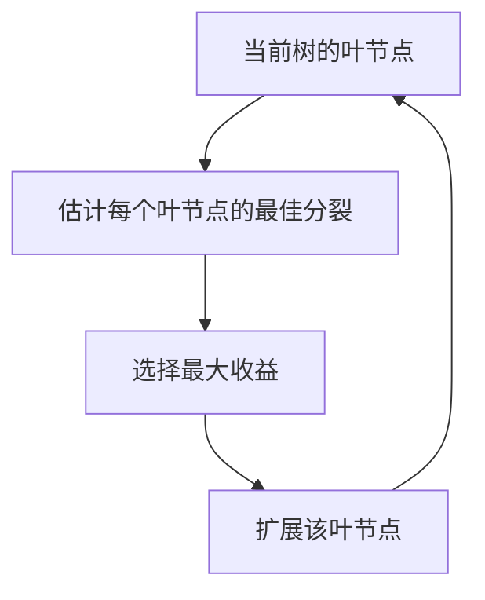

# LightGBM：高效训练大规模提升树

LightGBM 属于梯度提升决策树家族。它的特色主要是高效处理候选分裂、样本与特征的方法。这些技术并不能替代合适的损失函数、有代表性的验证数据和正则化。

## 直方图分裂

连续特征先被离散为若干箱。算法不再在每个节点检查所有原始不同值，而是按箱累计统计量并搜索箱边界。这样可以降低内存与分裂搜索成本，代价是阈值位置变成近似。

拥有一百万个不同值的特征可能只使用几百个箱。精确最优阈值可能落在某个箱内部，因此箱数体现速度与分辨率的权衡，也会影响不同数据集构建方式下的可复现性。

## 按叶生长

Leaf-wise，也称 best-first，会扩展预计损失下降最大的叶节点。在叶节点数相同时，它可能高效降低训练损失，但也可能产生很深且不平衡的树。应控制叶节点数、叶内最小数据量、适当的深度限制和正则化。

这不能证明 LightGBM 总比按层生长的方法好。XGBoost 也支持多种生长策略，具体配置很重要。

## 算例：扩展哪个叶节点

三个叶节点的最佳分裂收益分别为 0.8、3.2、0.4。Best-first 会扩展第二个。如果它只有很少样本，表面收益可能只是噪声；最小数据量或 Hessian 约束可以拒绝该分裂。很大的训练收益不能代替验证效果的改善。

## GOSS 与 EFB

梯度单边采样 GOSS 保留大梯度样本，再抽取一部分小梯度样本，并在收益估计中使用校正权重。目标是在减少工作量的同时保留有信息的训练统计量。但大梯度不总代表有价值的样本：错标或损坏的数据也可能产生大梯度。

互斥特征捆绑 EFB 将很少或从不同时非零的稀疏特征打包，降低实际特征处理负担。它不是任意降维，也不意味着相关的稠密列可以随意无损合并。

这些是有文档说明、受配置控制的技术，不能假定每次 LightGBM 运行都会以相同方式启用所有优化。

## 进阶理解

先使用适中的叶节点预算和基于验证集的停止规则，再联合调整学习率与轮数。对稀疏高维数据，应确认稀疏性和特征结构是否真的符合优化前提。小数据集应严格约束叶节点，并和更简单模型比较。

训练速度取决于样本数、特征数、箱数、稀疏度、硬件、线程数和配置。应测量包括数据集构建在内的端到端时间，而不是笼统重复某个包更快。

**思考：**为什么增加箱数可能改善拟合，却占用更多内存？**答案：**更细的阈值分辨率需要更多直方图存储和处理。

接着阅读 [XGBoost](xgboost.md)、[决策树](decision-trees.md)和[过拟合](overfitting.md)。

## 来源与延伸阅读

- [LightGBM 特性](https://lightgbm.readthedocs.io/en/stable/Features.html)：直方图与按叶生长。
- [LightGBM 论文](https://proceedings.neurips.cc/paper/2017/hash/6449f44a102fde848669bdd9eb6b76fa-Abstract.html)：GOSS 与 EFB。
