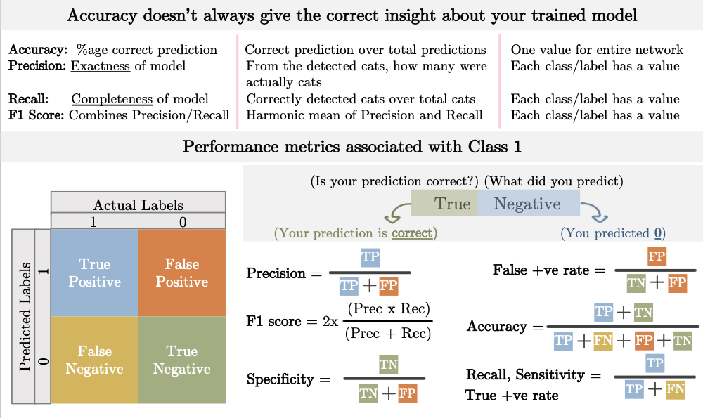
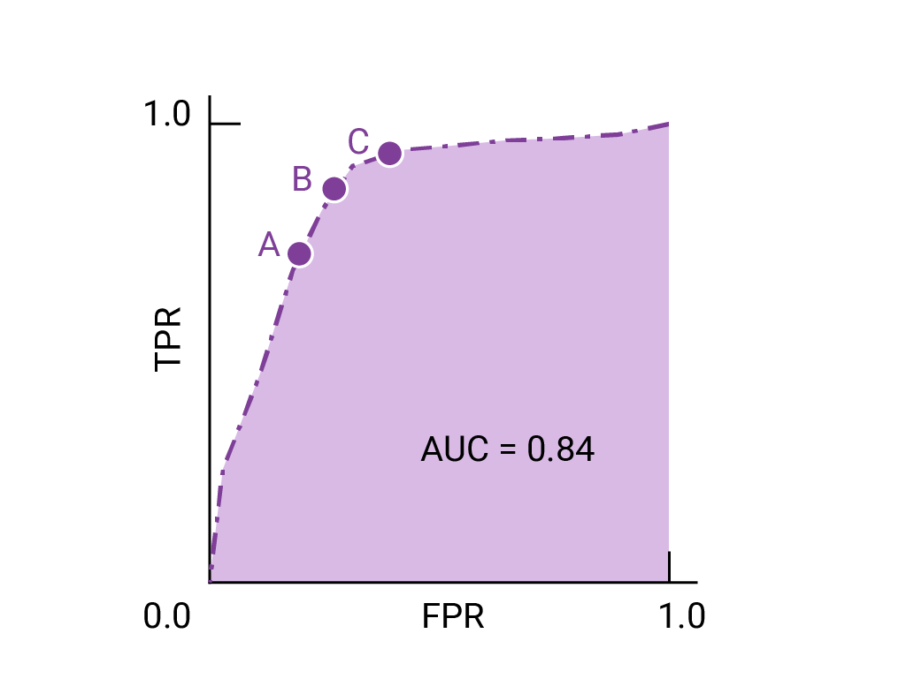

# 📏 评估指标：连接模型分数与决策

指标将许多预测压缩成一个数字。有用的提问不是“哪个指标最好？”而是“哪些错误在什么操作点对哪个群体重要？”在比较模型之前，定义这些选择。

## 🧭 分类从混淆矩阵开始

对于指定的正类，真正阳性（TP）是正确检测到的阳性，假阳性（FP）是误报，假阴性（FN）是漏报。

$$
\text{精确率}=\frac{TP}{TP+FP},\qquad
\text{召回率}=\frac{TP}{TP+FN},\qquad
F_1=\frac{2TP}{2TP+FP+FN}.
$$

精确率问警报的可信度是多少。召回率问有多少目标群体被找到。F1将它们结合在一起，但忽略了真正阴性，并且不直接编码错误的财务或运营成本。显式处理未定义的分母，而不是静默地将每个空情况视为完美。

## 🧩 工作示例：为什么准确率会误导

在1000个案例中，20个是正类。一个总是预测负值的模型有98%的准确率和零召回率。另一个模型捕获了16个正类，但产生了24个误报。它有TP=16, FP=24, FN=4, TN=956：精确率为40%，召回率为80%，准确率为97.2%。

第二个模型的准确率较低，但如果漏报一个正类很昂贵，它可能更有用。它也可能使团队因误报而不堪重负。操作决策决定了偏好的权衡。

```python
# runnable-example
TP, FP, FN, TN = 16, 24, 4, 956
assert TP / (TP + FP) == 0.4
assert TP / (TP + FN) == 0.8
assert (TP + TN) / 1000 == 0.972
```

## 📌 分数、阈值和概率

改变分类阈值会改变混淆矩阵，而不改变排名模型。ROC曲线绘制真正阳性率与假阳性率；精确率-召回率曲线专注于正类检测，并且在严重不平衡时通常更揭示信息。它们的值仍然取决于评估设置，而精确率依赖于正类占比。

高排名分数并不保证校准的概率。如果100个案例收到概率 0.8，校准会问是否在重复可比案例中大约有80个是正类。对数损失和布里耶评分评估概率预测；可靠性图使校准错误可见。

### ROC AUC 衡量什么

AUC是随机选择一个正样本比随机选择一个负样本得分更高的概率，平局算一半：

$$
\mathrm{AUC}=\frac{\sum_{i\in +}\sum_{j\in -}[\mathbf{1}(s_i>s_j)+\tfrac12\mathbf{1}(s_i=s_j)]}{n_+n_-}.
$$

等价地，按升序排序分数并给平局分配平均排名。如果 $R_+$ 是正样本的排名和，则 $\mathrm{AUC}=[R_+-n_+(n_++1)/2]/(n_+n_-)$。用梯形积分ROC曲线得到相同的结果。对于正样本0.9和0.5以及负样本0.5和0.1，三个对获胜，一个平局，所以AUC是 $3.5/4=0.875$。当评估集只包含一个类别时，AUC未定义。



混淆矩阵图定义了TP、FP、FN和TN对于所选的正类。精确率和召回率有不同的分母；在不平衡的情况下，仅准确率可能隐藏了不良的正类检测。



阴影ROC区域是所展示曲线的AUC，图像中标记为0.84。它与下面的工作示例中的数字0.875分开；这两个数字都不是模型在不同数据集上的固定属性。

## 📊 回归和多分类评估

MAE报告目标单位的平均绝对误差。RMSE强调大误差同时保留这些单位。$R^2$将平方误差与均值预测参考进行比较，可以在保留数据上为负。MAPE在零附近不稳定，并且当百分比误差没有有意义的分母时不适合使用。

在多分类问题中，宏平均给每个类别相等的权重；微平均汇总决策；加权平均根据支持度加权类别。一个单一的加权分数可能隐藏了不良的小类表现。此外，报告每类或有意义的子组结果。

## 🎯 进一步学习

在相同的观察上比较模型，并使用适当的配对重采样方法量化不确定性。对于重复用户，重采样用户而不是假装行是独立的。在验证数据上选择阈值，冻结它们，然后评估最终测试集。

**练习：** 如果部署正类占比下降而灵敏度和特异度保持不变，精确率会发生什么变化？**答案：** 通常会下降，因为误报占正预测的比例更大。

继续阅读 [损失函数](loss-functions.md)，[数据清洗](data-cleaning.md) 和 [LLM评估](../llm/courses/llm/evaluation.md)。

## 📚 参考来源和进一步阅读

- [scikit-learn：模型评估](https://scikit-learn.org/stable/modules/model_evaluation.html) 定义了分类和回归指标。
- [scikit-learn：概率校准](https://scikit-learn.org/stable/modules/calibration.html) 将排名与校准分开。
