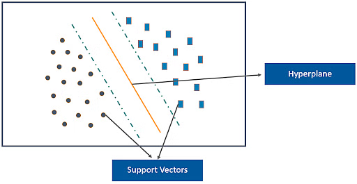

# 📐 支持向量机：通过最大间隔分类

支持向量机（SVM）在控制其周围的间隔的同时选择决策边界。对于线性二元分类器，得分是 $f(x)=w^Tx+b$，预测是其符号。几何间隔将分类与正则化联系起来。

## 🧭 从分离线到软间隔

硬间隔SVM寻求在数据可分时宽的分离间隔。现实中的数据集通常包含重叠或误标记的观察值，因此软间隔目标允许违反：

$$
\min_{w,b,\xi}\frac12\|w\|^2+C\sum_i\xi_i,
\quad y_i(w^Tx_i+b)\geq1-\xi_i,\quad\xi_i\geq0.
$$

标签是 $y_i\in\{-1,1\}$。等价的无约束形式使用合页损失。$C$ 在边际违反和权重范数之间进行权衡。较大的 $C$ 强调拟合违反，但其对泛化的实际影响必须经过验证。

支持向量是对偶问题的解中具有非零系数的观测值。在软间隔模型中，它们可以位于间隔上、内部或边界错误的一侧；“最近正确分类点”不完整。

## 🧩 实例：边际违反

对于正标签，得分2、0.5和−1分别有合页损失0、0.5和2。中间的点被正确分类但仍然在期望的单位函数间隔内。这解释了为什么一个正确分类的样本可以影响训练。

```python
# runnable-example
hinge = lambda y, score: max(0, 1 - y * score)
assert [hinge(1, s) for s in [2, 0.5, -1]] == [0, 0.5, 2]
```



橙色超平面将图示的类别分开；虚线平行线标记间隔。最近的训练点是支持向量，它们约束边界。在软间隔SVM中，允许违反并带有惩罚，因此不必每个点都保持在间隔外。

## 📌 核函数：改变相似性而不列出每个特征

核计算特征空间中的内积，$K(x,z)=\langle\phi(x),\phi(z)\rangle$。线性、多项式和径向基函数（RBF）核代表不同的假设。对于RBF核，

$$
K(x,z)=\exp(-\gamma\|x-z\|^2).
$$

较大的 $\gamma$ 使影响高度局部化；较小的 $\gamma$ 使相似性变化得更慢。在缩放特征后，应联合调整 $C$ 和 $\gamma$。多项式核建模某些特征交互；其阶数也控制复杂度。Sigmoid形状的核对每个参数选择不一定为半正定，并且不如其他方法直观。

核并不保证实际问题变得有用地可分。过多的灵活性可能会拟合噪声，表示可能仍然错过信号。

## 🔍 进阶理解

当样本量增大时，核方法可能消耗大量内存和计算；预测成本也取决于支持向量的数量。对于大规模稀疏文本数据，线性求解器可能比 RBF 核更实用。应根据数据规模和资源预算选择核函数，而不是假设存在普遍最优的默认选项。

SVM 分数并不自动是概率。若需要可靠概率，还须进行概率校准，并严格遵守训练集与验证集划分。基于距离的核对单位敏感，因此特征缩放必须放在交叉验证流程内部，避免数据泄漏。

**练习：**仅改变一个输入特征的缩放，为什么会改变 RBF 模型？**答案：**平方距离随之改变，相似性所依赖的几何结构也改变，即使原始观测对象没有变。

## 📚 来源与延伸阅读

- [scikit-learn: 支持向量机](https://scikit-learn.org/stable/modules/svm.html)涵盖了核、缩放和求解器行为。
- [LIBSVM指南](https://www.csie.ntu.edu.tw/~cjlin/papers/guide/guide.pdf)提供了一个实用的验证工作流程。
