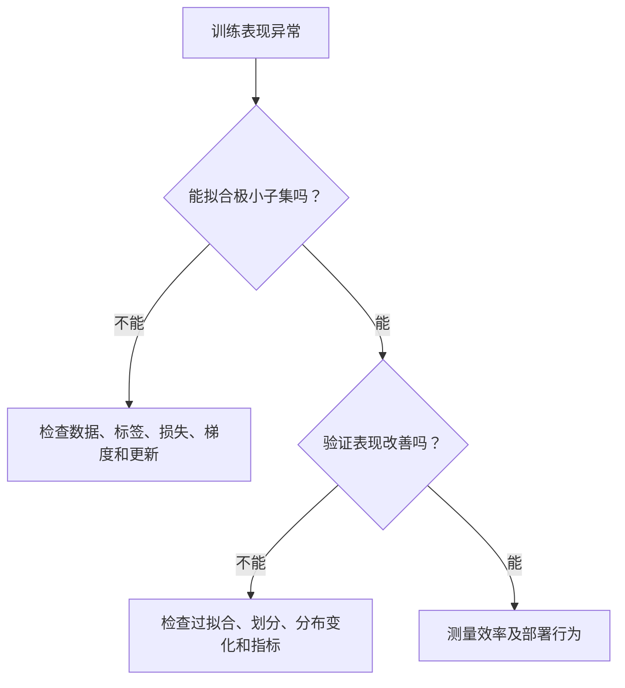

# 神经网络训练问题：先识别失败类型

训练失败时，首先换架构往往代价最高。先判断问题来自数据、目标、实现、优化、泛化，还是部署不匹配。看起来相似的损失曲线，可能有完全不同的原因。

## 先证明实验确实能学

使用极小、固定的数据集，暂时关闭增强和强正则。表达能力足够的模型应该能够拟合一致的小任务。若做不到，检查目标对齐、张量形状、损失归约、冻结参数，以及优化器是否真的更新。

语言模型中常见一位错位：下一词元目标下，位置 $t$ 的 Logit 通常预测 $t+1$ 的词元。如果训练模型复现同一位置已经可见的词元，损失可能很好看，却没有实际意义。

## 梯度消失与爆炸

反向传播不断相乘局部 Jacobian。重复收缩会让远处梯度变小，重复放大会让梯度变大。饱和激活、深度、循环转移、初始化和数值精度都会影响这个乘积。

按层检查范数，不要只看全局平均。残差连接提供更短的信号路径，合适的初始化和归一化帮助保持有效尺度。梯度裁剪限制更新幅度，却不能修复错误标签，也不保证循环网络学会长依赖。

阈值为 $c$ 的全局范数裁剪，将 $g$ 替换为 $g\min(1,c/\|g\|)$。若 $\|g\|=20$、$c=5$，每个分量乘 0.25，方向保持不变；逐坐标裁剪通常会改变方向。

## 数值失败

NaN 可能在梯度产生之前就出现在前向过程：除零、对非正数取对数、指数溢出、无效掩码都可能引发它。应寻找第一个非有限张量。基于 Logits 的融合损失可避免许多可预防的不稳定。

混合精度中，小梯度可能下溢，大激活可能上溢。Loss Scaling 处理部分梯度下溢，不解决所有上溢。不同浮点格式的指数范围和有效位精度不同，仅说“16 位”不足以诊断问题。

## 区分优化与泛化

训练和验证误差都高，可能来自容量不足、优化差、特征错误或目标噪声。降低学习率、训练更久并不总有效，原本步长就可能过小。

训练误差低、验证误差高，应检查划分、学习曲线、正则化和数据代表性。单独一个低验证分数，无法确定哪种干预正确。见[过拟合](overfitting.md)。

## 进阶

测量实际训练循环：每秒样本数或词元数、等待数据时间、加速器利用率、峰值内存和通信时间。梯度检查点以重算交换激活内存。大批次可能提高硬件效率，也会改变优化；固定 Epoch 数时，还会减少更新次数。

**练习：**损失不变，所有梯度都是 `None`，裁剪有帮助吗？**答案：**没有。应调查张量被 Detach、梯度跟踪关闭、参数冻结，或者损失没有连接到可训练权重。

资料：[PyTorch Autograd 机制](https://docs.pytorch.org/docs/stable/notes/autograd.html)、[残差学习论文](https://arxiv.org/abs/1512.03385)、[自动混合精度示例](https://docs.pytorch.org/docs/stable/notes/amp_examples.html)。
