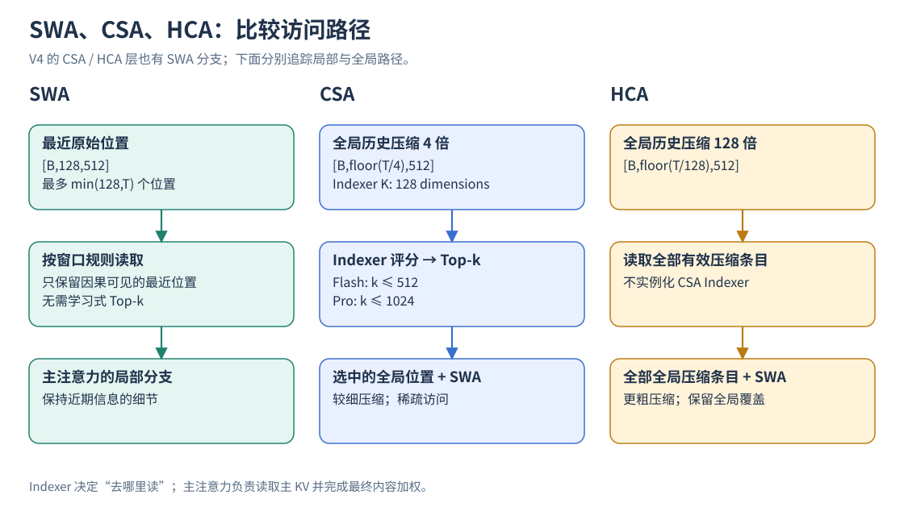

# 🔎 SWA、CSA、HCA 与 Indexer：一层 Attention 到底读什么

先分清两个问题：**缓存中保存什么**，以及**本次 Query 读取哪些位置**。SWA 约束最近窗口，CSA/HCA 压缩全局历史，Indexer 则负责在候选位置里做选择。

本页以 DeepSeek-V4 为主线；GLM 的 DSA 与 V4.1 的 CSA2 在后文单独对照。

??? note "配置与实现依据"

    机制参考 [DeepSeek-V4 报告 §2.3](https://arxiv.org/html/2606.19348v1#S2.SS3)及本栏固定的[官方参考实现](https://huggingface.co/deepseek-ai/DeepSeek-V4-Flash/blob/60d8d70770c6776ff598c94bb586a859a38244f1/inference/model.py)。数值对应 [Flash / Pro 配置](deepseek-v4.md)，不是所有名为 CSA 或 SWA 的模型的通用参数。

## 🗺️ 四者的分工

<figure class="model-figure" markdown="1">

<figcaption markdown="span">比较的是三条访问路径。V4 的 CSA/HCA 层同时保留 SWA 分支，并非一层只能三选一。</figcaption>

</figure>

| 名称 | 核心问题 | V4 中的做法 |
| --- | --- | --- |
| SWA：Sliding Window Attention | 最近的原始信息怎么保留？ | 读取最近最多 128 个位置 |
| CSA：Compressed Sparse Attention | 较细的全局历史如何少读？ | 按 4 倍压缩，再由 Indexer 选择 Top-k |
| HCA：Heavily Compressed Attention | 如何低成本保留全局概貌？ | 按 128 倍压缩，读取已完成的全部压缩条目 |
| Indexer | 候选历史中哪些位置值得读？ | 用轻量 Query/Key 评分，输出位置 ID |

## 🪟 SWA：保留最近窗口

### 读哪些位置

对当前位置，只访问因果可见范围内最近的窗口。若窗口为 128，最多读取 `min(128,T)` 个局部位置；短上下文不会凭空补成 128 个有效 Token。

### 保存什么

V4 的局部缓存是共享潜在 KV，逻辑窗口为 `[B,128,512]`。它不是为每个 Query 头各存一份完整 K 和 V。

参考 Decode 路径用环形缓冲区更新窗口槽位。窗口外的原始局部 KV 可以退出该窗口，但历史仍可能由额外的全局压缩路径表示。

## 🧩 CSA：先压缩，再选择

### 一次 Query 的流程

1. **压缩历史。**Compressor 将一组历史隐藏状态投影、门控池化，形成更短的全局 KV 序列。

2. **为候选评分。**Indexer 使用较小的索引 Query/Key，计算哪些压缩位置相关。

3. **选择 Top-k。**保留最多 k 个因果可见的压缩位置 ID。

4. **执行主注意力。**主 Query 同时读取 SWA 窗口和选中的压缩 KV。

在 V4 中，压缩比例为 4。Compressor 是带学习参数的 gated pooling，并包含重叠处理；不是简单地每隔 4 个 Token 取一个，也不只是固定平均。

### Shape 沿哪条轴缩短

令已完成的压缩条目数为 $M_4=\lfloor T/4\rfloor$：

| 对象 | 逻辑 shape |
| --- | --- |
| 全局主 KV | `[B,M4,512]` |
| Indexer Key | `[B,M4,128]` |
| 主 Query | Flash `[B,S,64,512]`；Pro `[B,S,128,512]` |
| 选中位置 ID | `[B,S,min(k,M4)]`，还需满足逐 Query 的因果边界 |

Flash 的 k 上限为 512，Pro 为 1024。Top-k 限制的是**本次读取量**；没有选中的压缩条目仍可能留在缓存里，供之后的 Query 使用。

## 🗜️ HCA：压得更短，再读取全局条目

HCA 用更高的压缩比例换取较短的全局序列。在本栏 V4 配置中，比例为 128，全局主 KV 为 `[B,floor(T/128),512]`。

这条路径不实例化 CSA 的学习式 Indexer，而是读取当前因果可见的全部已完成压缩条目，并与局部 SWA 位置共同参与主注意力。

因此，**HCA 没有 Indexer 不代表没有全局信息**。它使用的全局信息压得更粗，与 CSA 从较细条目中选择少数位置是不同的取舍。

## 🔎 Indexer：输出地址，不输出最终 Attention 结果

### 参考实现中的计算链

1. 把低秩 Q 状态投影成索引 Query：V4 为 `[B,S,64,128]`。

2. 将压缩历史表示为索引 Key `[B,M4,128]`。

3. 计算每个索引头的相关分数，经 ReLU 和头权重组合，形成 `[B,S,M4]` 评分。

4. 屏蔽未来或无效位置，再输出 Top-k ID，交给主注意力读取 512 维主 KV。

Indexer 的 128 维 Key 与主 KV 的 512 维向量不是同一份张量。它选出“去哪里读”，主注意力才完成最终的内容加权。

!!! note "稀疏主注意力不等于整条链都没有扫描成本"

    主注意力即使只读固定数量的位置，Indexer 仍可能对不断增长的候选序列评分。评估时要分别计入压缩、评分、Top-k、主注意力和缓存访问成本。

## 🧮 算例：T = 65536

假设历史已形成完整压缩组，当前 Query 可见全部这些条目。下表只数访问位置，不是带宽或延迟测试。

| 路径 | 全局缓存条目数 | 本次最多读取的主注意力位置 |
| --- | ---: | --- |
| 纯 SWA | 无全局分支 | 128 个局部位置 |
| Flash CSA | 65536 / 4 = 16384 | 128 局部 + 512 选中压缩位置 |
| Pro CSA | 16384 | 128 局部 + 1024 选中压缩位置 |
| HCA | 65536 / 128 = 512 | 128 局部 + 512 全局压缩位置 |

Flash CSA 与 HCA 在这个例子里都可读取 640 个位置，但信息粒度和额外选择成本不同。不能只凭位置数相同就断言精度、计算量或速度相同。

## 🔄 放回 GLM、V4 与 V4.1

| 模型 | Indexer 面对的候选 | 跨层复用什么 |
| --- | --- | --- |
| GLM-5.1 DSA | 历史 Token 对应的索引 Key | 各层独立计算 |
| GLM-5.2 IndexShare | 历史 Token 对应的索引 Key | 复用 Top-k；主 MLA KV 仍归每层自己 |
| V4 CSA | 比例 4 的压缩位置 | 本栏 V4 逐层拥有缓存 |
| V4 HCA | 不做学习式 Top-k 选择 | 读取更重压缩后的全局条目 |
| V4.1 CSA2 | 来源层生成并共享的全局位置 | 分别复用主 KV、Indexer Key 或 Top-k |

V4.1 的 Full、Reindex、Reuse 表示不同资源职责，不是 V4 的 4/128 比例交替。具体层号见 [V4.1 缓存所有权](deepseek-v4-1.md)；GLM 的索引复用见 [GLM-5.2](glm-5-2.md)。

## 📌 阅读模型配置时的检查顺序

1. 确认这一层有哪些局部与全局路径。

2. 看压缩比例、有效历史长度及未完成分组状态。

3. 看有没有 Indexer，以及 k 作用于原始位置还是压缩条目。

4. 确认缓存、Key、选中 ID 分别由谁拥有或共享。

5. 最后计算主注意力读取量、缓存字节和实际执行开销。

主干各层的路径分布与投影 shape，可继续查阅 [V4 Flash / Pro](deepseek-v4.md)；缓存何时可被下一层或远端消费，见[逐层执行与传输](../ml/llm/inference/layerwise-inference.md)。
