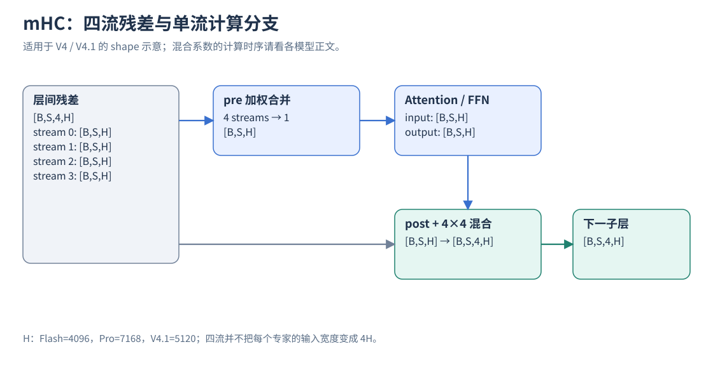
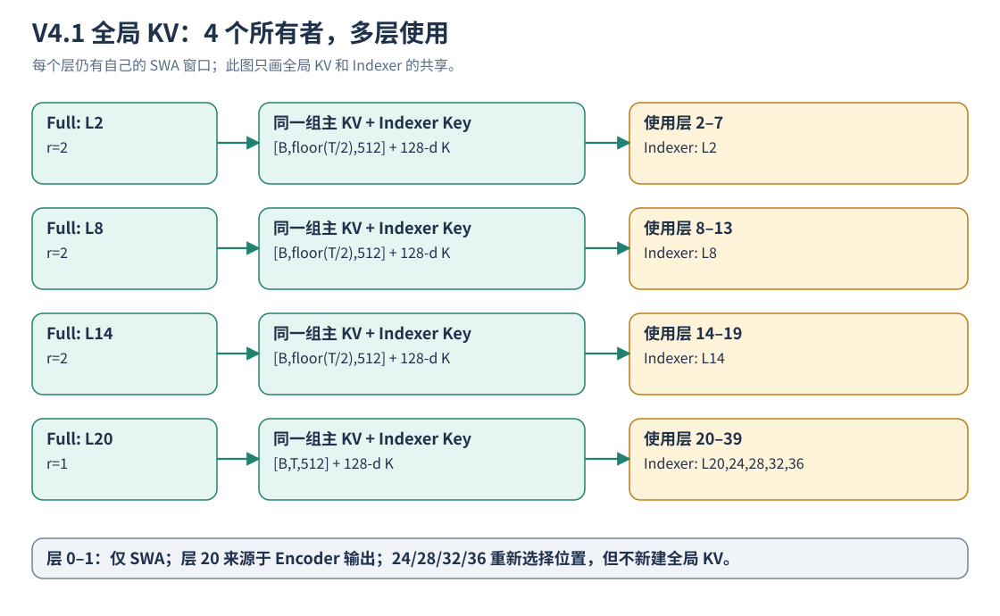
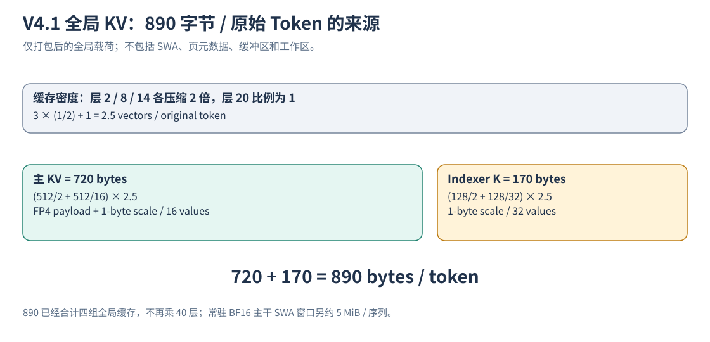
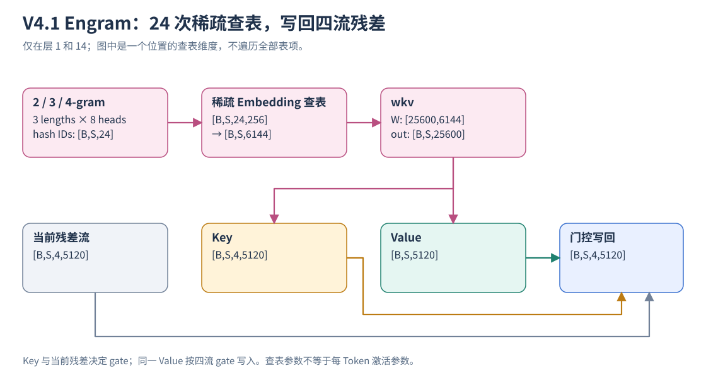
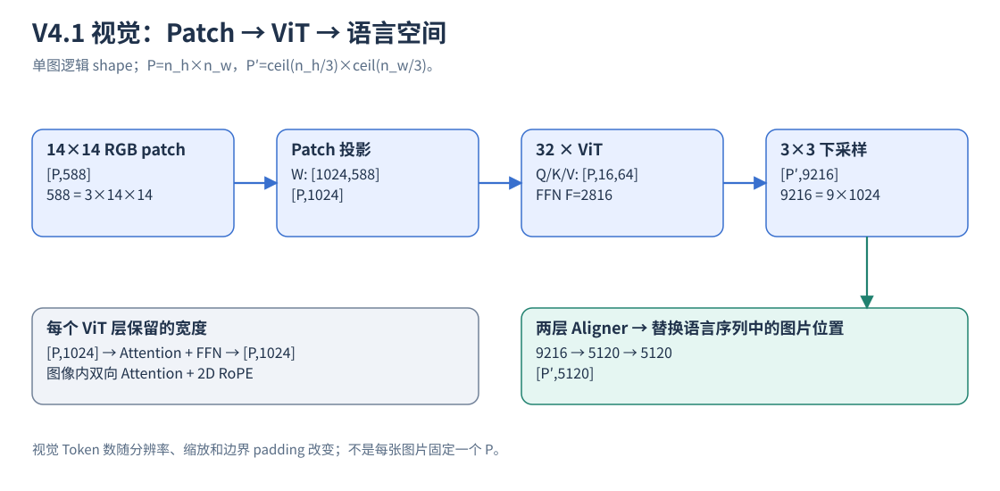
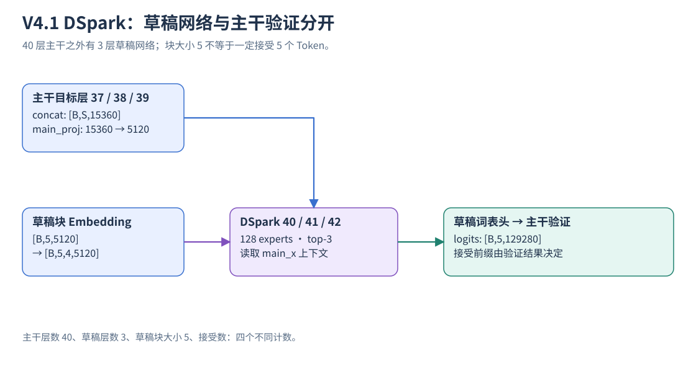

# 🧠 DeepSeek-V4.1 Flash：CED、共享 KV、Engram 与视觉 Shape

本页绑定 [V4.1-Flash 官方配置](https://huggingface.co/deepseek-ai/DeepSeek-V4.1-Flash/blob/314113f8a7dadb388215396ba5fbee2c610a04d6/config.json)及同版[文本参考实现](https://huggingface.co/deepseek-ai/DeepSeek-V4.1-Flash/blob/314113f8a7dadb388215396ba5fbee2c610a04d6/inference/model.py)。本次核对的 Flash-1017 配置与它相同；不据此推断两个 checkpoint 的权重相同。这里不为未取得配置的 V4.1-Pro 填入推测值。

## 🗺️ 这不是只给 V4 增加几个参数

| 项目 | 配置 |
| --- | --- |
| 文本主干 / 隐藏宽度 / 词表 | 40 层 / 5120 / 129280 |
| CED 划分 | 0–19 因果 Encoder，20–39 Decoder |
| 主 Q 头 / 头宽 / Q 低秩 | 64 / 512 / 1280 |
| O 分组 / 每组低秩 | 8 / 1024 |
| 路由专家 / top-k / 共享专家 / F | 384 / 6 / 1 / 2304 |
| SWA 窗口 / mHC 扩展 | 128 / 4 |
| 主 KV 来源层 | 2、8、14、20 |
| Indexer 执行层 | 2、8、14、20、24、28、32、36 |
| Indexer 头 / 头宽 / top-k | 32 / 128 / 512 |
| Engram 所在层 / 额外 DSpark 层 | 1、14 / 3 |
| 视觉主干 | 32 层，H=1024，16 头，FFN=2816，Patch=14 |

官方将模型定义为 **Causal Encoder–Decoder（CED）**：Decoder 的全局 KV 由最终 Encoder 状态提供，而非每个 Decoder 层各自产生一套全局 KV。它不是把原来的 Decoder-only 换个名称，也不是直接照搬双向 Encoder 的经典翻译模型。[官方模型卡](https://huggingface.co/deepseek-ai/DeepSeek-V4.1-Flash/blob/314113f8a7dadb388215396ba5fbee2c610a04d6/README.md)说明了该区别。

## 📐 文本每层主投影

层间四流残差为 `[B,S,4,5120]`，子层输入/输出为 `[B,S,5120]`。每层 Attention/FFN 的 mHC 混合投影各 `[24,20480]`；V4.1 的 Single-Pass mHC 把计算出的混合系数用于后续子层，不能把 V4 的执行顺序原样套入。

| 模块 | 逻辑权重 / 激活 shape |
| --- | --- |
| Embedding / 未绑定 Head | 各 `[129280,5120]` |
| `wq_a` / Q norm / `wq_b` | `[1280,5120]` / `[1280]` / `[32768,1280]` |
| Q 与 Attention 输出 | `[B,S,64,512]`；其中 RoPE 为末 64 维 |
| 局部 `wkv` / KV norm | `[512,5120]` / `[512]` |
| 分组 `wo_a` | 存储视图 `[8192,4096]`，运算视图 `[8,1024,4096]` |
| `wo_b` | `[5120,8192]` |
| Router | `[384,5120]`；分数 `[N,384]`，选中 ID/权重 `[N,6]` |
| 单专家 gate/up → down | 各 `[2304,5120]` → `[5120,2304]` |
| 共享专家 | 一个相同 F/H 的专家；所有 Token 参与 |

每层局部 SWA 都保留自己最近窗口的 KV；**全局** KV 只有少数所有者。两类缓存不能混为一谈。全局投影/压缩与本层局部 `wkv` 也不是同一个模块。

## 🔎 CSA2：Full、Reindex、Reuse

*图：层 20–39 使用同一组全局 KV；24、28、32、36 仅重新选择位置。每层独立 SWA 窗口另行保留。*

| 层 / 模式 | 生成全局 KV / Indexer K | 重算 Top-k | 使用哪套全局 KV |
| --- | --- | --- | --- |
| 0、1：SWA | 无全局路径 | 否 | 无 |
| 2、8、14：Full | 是，序列比例 2 | 是 | 自己的新缓存组 |
| 20：Full | 是，比例 1，投影 Encoder 输出 | 是，并产生候选块 | 层 20 缓存组 |
| 24、28、32、36：Reindex | 不重新生成共享 Key | 是 | 层 20 缓存组 |
| 其他层：Reuse | 否 | 复用最近 Indexer 层的结果 | 最近 Full 层的缓存组 |

主全局 KV 的逻辑存储分别是层 2、8、14 的 `[B,floor(T/2),512]`，以及层 20 的 `[B,T,512]`。对应 Indexer Key 为同样序列长度、最后一维 128；只有四个所有者持有它们。Indexer Query 为 `[B,S,32,128]`，`wq_b=[4096,1280]`；所有者将 512 维潜在 KV 用 `wk=[128,512]` 转为 Indexer K。

层 20 的候选选择最多取 2048 个块，每块 8 个位置；较深 Reindex 层在候选池内重新选 Top-512。`Full` 指该层拥有并发布共享资源，不表示对全部历史做 Dense Attention；`Reuse` 不跳过该层的 Q、SWA 或 FFN。

## 🧮 890 字节 / Token 怎样算出来

按官方描述的打包格式：主 KV 每 16 个 FP4 元素配一个单字节 scale，Indexer K 每 32 个 FP4 元素配一个单字节 scale。四组缓存折算到原始 Token 的密度为 `3/2+1=2.5`：

$$b_{main}=(512/2+512/16)\times2.5=720,$$
$$b_{index}=(128/2+128/32)\times2.5=170.$$

全局缓存合计 **890 字节 / 原始 Token**。这里不包括 SWA 窗口、压缩器状态、分配舍入、路由/页元数据和 DSpark 状态；不能再将 890 乘以 40。公式是从配置与量化格式推导的载荷模型，实际代码还可能采用未打包的数值仿真缓冲区。[官方模型卡](https://huggingface.co/deepseek-ai/DeepSeek-V4.1-Flash/blob/314113f8a7dadb388215396ba5fbee2c610a04d6/README.md)报告了相同全局载荷口径。

若仅把 40 个主干层的 `[B,128,512]` SWA 窗口按 BF16 常驻计算，B=1 为 **5 MiB**，不随长历史线性增长。SWA bounded replay 可以重建近期窗口，是否保留、卸载或重放由执行路径决定，不能把窗口状态当作不存在。

## 🗃️ Engram：层 1 与层 14 的条件查表

配置中的两个 Embedding 表分别为 `[384006168,256]` 和 `[384016682,256]`，逻辑参数合计 196,613,849,600。这里的 8 个 Engram 头与 384 个 MoE 专家不是同一套分组。对 2/3/4-gram 各做 8 路哈希，共 24 个地址，得到 `[B,S,24,256]`，拼成 `[B,S,6144]`。

`wkv=[25600,6144]` 将结果投影为 Key `[B,S,4,5120]` 与 Value `[B,S,5120]`，经与当前残差流的匹配门控写回 `[B,S,4,5120]`。这不是每个 Token 遍历全部约 196.6B 表项。[官方 Engram 实现](https://huggingface.co/deepseek-ai/DeepSeek-V4.1-Flash/blob/314113f8a7dadb388215396ba5fbee2c610a04d6/inference/engram.py)定义哈希表组织，文本模型代码定义投影和门控。

模型卡的 **552B backbone** 与 Engram 约 196B 是分开的口径；Hugging Face 按权重文件统计的总参数还可能包含额外模块。不要把 552B、存储总参数、每 Token 激活参数和量化字节互相替代。模型卡给出的 8B Prefill / 16B Decode 是其 CED 执行口径；参考脚本的具体执行调度不应自动视作生产最优路径。

## 🖼️ 视觉的每层 Shape

以一张图片产生 `n_h×n_w` 个 14×14 Patch 为例，令 P 为 Patch 数、`P'=ceil(n_h/3)×ceil(n_w/3)`。裁剪、缩放和分辨率使 P 动态变化，不能给所有图片写一个固定 Token 数。

| 视觉模块 | 权重 / 输出 |
| --- | --- |
| Patch 投影 | `[1024,588]`，588=3×14×14；`[P,588] → [P,1024]` |
| ViT 层 0–31：QKV / O | `[3072,1024]` / `[1024,1024]`；Q/K/V 各 `[P,16,64]` |
| ViT 层 0–31：融合 gate+up / down | `[5632,1024]` / `[1024,2816]`；每分支宽 2816 |
| 每层 ViT 输入/输出与最终 norm | `[P,1024]`，norm `[1024]` |
| 3×3 Pixel-unshuffle | `[P,1024] → [P',9216]`，边界按实现 padding |
| 两层 Aligner | `[5120,9216]` → `[5120,5120]`；输出 `[P',5120]` |

ViT 使用图像内双向 Attention 与 2D RoPE；视觉 Embedding 替换语言序列中的图片位置，再与文本一起进入主干。表中是单图参考代码视图，批量实现可能增加 B 轴。依据[官方视觉代码](https://huggingface.co/deepseek-ai/DeepSeek-V4.1-Flash/blob/314113f8a7dadb388215396ba5fbee2c610a04d6/inference/vision.py)。

## ⏩ DSpark 的 3 层不是 3 个普通主干层

配置给出额外预测层 40–42、草稿块大小 5、目标层 `[37,38,39]`。从这三个层取得的隐藏状态合并为末维 15360，`main_proj=[5120,15360]`；草稿隐藏可为 `[B,5,4,5120]`。草稿专家为 128 个、top-3，与主干 384/top-6 不同。最终草稿 logits 可为 `[B,5,129280]`，后续还需要验证与接受策略。

`compress_ratios` 的末 3 项是这三个预测层的 0，不属于 40 层主干。主干层数、草稿网络深度、草稿块大小、实际接受 Token 数是四个不同数量。参见[推测解码](../ml/llm/inference/multi-token-prediction.md)。

## 🪜 完整文本主干层表

<!-- BEGIN GENERATED LAYERS deepseek-v4-1-flash -->
??? info "DeepSeek-V4.1-Flash · 40 主干层"

    | 层 | 四流残差输入/输出 | Attention | FFN | 全局 KV 来源 / 有效长度 | Indexer 来源 |
    | --- | --- | --- | --- | --- | --- |
    | 0 | `[B,S,4,5120]` | SWA | MoE | — | — |
    | 1 | `[B,S,4,5120]` | SWA | MoE + Engram | — | — |
    | 2 | `[B,S,4,5120]` | CSA2 Full, r=2 | MoE | L2: `[B,floor(T/2),512]` | L2; K from L2 |
    | 3 | `[B,S,4,5120]` | CSA2 Reuse, r=2 | MoE | L2: `[B,floor(T/2),512]` | L2; K from L2 |
    | 4 | `[B,S,4,5120]` | CSA2 Reuse, r=2 | MoE | L2: `[B,floor(T/2),512]` | L2; K from L2 |
    | 5 | `[B,S,4,5120]` | CSA2 Reuse, r=2 | MoE | L2: `[B,floor(T/2),512]` | L2; K from L2 |
    | 6 | `[B,S,4,5120]` | CSA2 Reuse, r=2 | MoE | L2: `[B,floor(T/2),512]` | L2; K from L2 |
    | 7 | `[B,S,4,5120]` | CSA2 Reuse, r=2 | MoE | L2: `[B,floor(T/2),512]` | L2; K from L2 |
    | 8 | `[B,S,4,5120]` | CSA2 Full, r=2 | MoE | L8: `[B,floor(T/2),512]` | L8; K from L8 |
    | 9 | `[B,S,4,5120]` | CSA2 Reuse, r=2 | MoE | L8: `[B,floor(T/2),512]` | L8; K from L8 |
    | 10 | `[B,S,4,5120]` | CSA2 Reuse, r=2 | MoE | L8: `[B,floor(T/2),512]` | L8; K from L8 |
    | 11 | `[B,S,4,5120]` | CSA2 Reuse, r=2 | MoE | L8: `[B,floor(T/2),512]` | L8; K from L8 |
    | 12 | `[B,S,4,5120]` | CSA2 Reuse, r=2 | MoE | L8: `[B,floor(T/2),512]` | L8; K from L8 |
    | 13 | `[B,S,4,5120]` | CSA2 Reuse, r=2 | MoE | L8: `[B,floor(T/2),512]` | L8; K from L8 |
    | 14 | `[B,S,4,5120]` | CSA2 Full, r=2 | MoE + Engram | L14: `[B,floor(T/2),512]` | L14; K from L14 |
    | 15 | `[B,S,4,5120]` | CSA2 Reuse, r=2 | MoE | L14: `[B,floor(T/2),512]` | L14; K from L14 |
    | 16 | `[B,S,4,5120]` | CSA2 Reuse, r=2 | MoE | L14: `[B,floor(T/2),512]` | L14; K from L14 |
    | 17 | `[B,S,4,5120]` | CSA2 Reuse, r=2 | MoE | L14: `[B,floor(T/2),512]` | L14; K from L14 |
    | 18 | `[B,S,4,5120]` | CSA2 Reuse, r=2 | MoE | L14: `[B,floor(T/2),512]` | L14; K from L14 |
    | 19 | `[B,S,4,5120]` | CSA2 Reuse, r=2 | MoE | L14: `[B,floor(T/2),512]` | L14; K from L14 |
    | 20 | `[B,S,4,5120]` | CSA2 Full, r=1 | MoE | L20: `[B,T,512]` | L20; K from L20 |
    | 21 | `[B,S,4,5120]` | CSA2 Reuse, r=1 | MoE | L20: `[B,T,512]` | L20; K from L20 |
    | 22 | `[B,S,4,5120]` | CSA2 Reuse, r=1 | MoE | L20: `[B,T,512]` | L20; K from L20 |
    | 23 | `[B,S,4,5120]` | CSA2 Reuse, r=1 | MoE | L20: `[B,T,512]` | L20; K from L20 |
    | 24 | `[B,S,4,5120]` | CSA2 Reindex, r=1 | MoE | L20: `[B,T,512]` | L24; K from L20 |
    | 25 | `[B,S,4,5120]` | CSA2 Reuse, r=1 | MoE | L20: `[B,T,512]` | L24; K from L20 |
    | 26 | `[B,S,4,5120]` | CSA2 Reuse, r=1 | MoE | L20: `[B,T,512]` | L24; K from L20 |
    | 27 | `[B,S,4,5120]` | CSA2 Reuse, r=1 | MoE | L20: `[B,T,512]` | L24; K from L20 |
    | 28 | `[B,S,4,5120]` | CSA2 Reindex, r=1 | MoE | L20: `[B,T,512]` | L28; K from L20 |
    | 29 | `[B,S,4,5120]` | CSA2 Reuse, r=1 | MoE | L20: `[B,T,512]` | L28; K from L20 |
    | 30 | `[B,S,4,5120]` | CSA2 Reuse, r=1 | MoE | L20: `[B,T,512]` | L28; K from L20 |
    | 31 | `[B,S,4,5120]` | CSA2 Reuse, r=1 | MoE | L20: `[B,T,512]` | L28; K from L20 |
    | 32 | `[B,S,4,5120]` | CSA2 Reindex, r=1 | MoE | L20: `[B,T,512]` | L32; K from L20 |
    | 33 | `[B,S,4,5120]` | CSA2 Reuse, r=1 | MoE | L20: `[B,T,512]` | L32; K from L20 |
    | 34 | `[B,S,4,5120]` | CSA2 Reuse, r=1 | MoE | L20: `[B,T,512]` | L32; K from L20 |
    | 35 | `[B,S,4,5120]` | CSA2 Reuse, r=1 | MoE | L20: `[B,T,512]` | L32; K from L20 |
    | 36 | `[B,S,4,5120]` | CSA2 Reindex, r=1 | MoE | L20: `[B,T,512]` | L36; K from L20 |
    | 37 | `[B,S,4,5120]` | CSA2 Reuse, r=1 | MoE | L20: `[B,T,512]` | L36; K from L20 |
    | 38 | `[B,S,4,5120]` | CSA2 Reuse, r=1 | MoE | L20: `[B,T,512]` | L36; K from L20 |
    | 39 | `[B,S,4,5120]` | CSA2 Reuse, r=1 | MoE | L20: `[B,T,512]` | L36; K from L20 |
<!-- END GENERATED LAYERS deepseek-v4-1-flash -->

将此模型做 PP 或逐层 KV 卸载时，必须保留缓存所有者与引用关系：一个 Stage 不能把“本层没有生成全局 KV”解释成“不需要历史 KV”。参见[并行策略](../ml/llm/inference/parallelism.md)和[逐层生命周期](../ml/llm/inference/layerwise-inference.md)。
