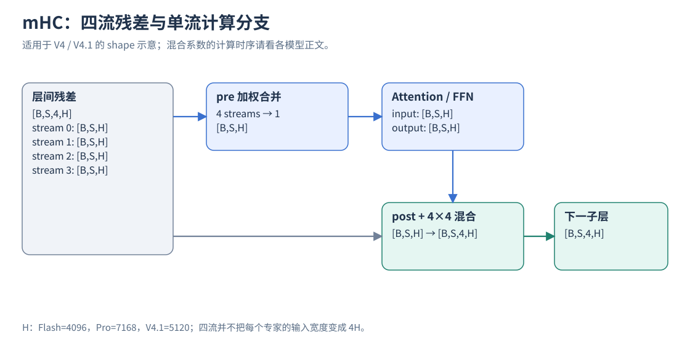
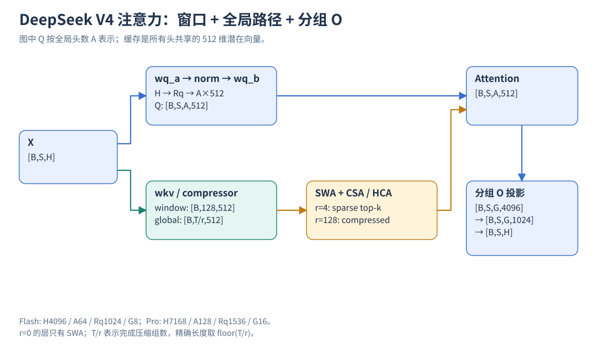

# 🧠 DeepSeek-V4 Flash / Pro：mHC、压缩注意力与专家 Shape

V4 Flash 与 Pro 都结合 **四流 mHC、压缩注意力和 MoE**。阅读时分别跟踪层间残差、Attention 分支和全局缓存；三者的 shape 不相同。

??? note "配置、实现与适用范围"

    本页分别绑定官方 [Flash 配置](https://huggingface.co/deepseek-ai/DeepSeek-V4-Flash/blob/60d8d70770c6776ff598c94bb586a859a38244f1/config.json)与 [Pro 配置](https://huggingface.co/deepseek-ai/DeepSeek-V4-Pro/blob/b5968e9190ef611bbf34a7229255be88a0e937c1/config.json)，模块 shape 由相同快照的[官方参考代码](https://huggingface.co/deepseek-ai/DeepSeek-V4-Flash/blob/60d8d70770c6776ff598c94bb586a859a38244f1/inference/model.py)推导。这里不是 Flash-0731、Pro-0813 或 API 动态别名的规格表；其他 checkpoint 需重新核对。

## 🗺️ 全局维度

| 项目 | V4-Flash | V4-Pro |
| --- | ---: | ---: |
| 主干层数 / 隐藏宽度 H | 43 / 4096 | 61 / 7168 |
| 词表 | 129280 | 129280 |
| Q 头数 / 每头宽度 | 64 / 512 | 128 / 512 |
| NoPE / RoPE 维度 | 448 / 64 | 448 / 64 |
| Q 低秩维度 | 1024 | 1536 |
| O 分组数 / 每组低秩维度 | 8 / 1024 | 16 / 1024 |
| 路由专家 / top-k / 共享专家 | 256 / 6 / 1 | 384 / 6 / 1 |
| 每专家 FFN 中间宽度 F | 2048 | 3072 |
| Hash 路由层 | 0、1、2 | 0、1、2 |
| 滑动窗口 / mHC 扩展数 | 128 / 4 | 128 / 4 |
| Indexer 头数 × 头宽 / top-k | 64 × 128 / 512 | 64 × 128 / 1024 |
| 最大位置数 / 额外 MTP 层数 | 1048576 / 1 | 1048576 / 1 |

模型卡的主干参数口径为 Flash 284B、每 Token 激活 13B，Pro 1.6T、激活 49B；这不是把存储的所有专家都算作每步激活。[官方模型卡](https://huggingface.co/deepseek-ai/DeepSeek-V4-Flash/blob/60d8d70770c6776ff598c94bb586a859a38244f1/README.md)与 [V4 报告](https://arxiv.org/abs/2606.19348)给出架构背景。

## 🪜 层间残差与分支输入不是同一个 Shape

<figure class="model-figure" markdown="1">

</figure>

Embedding 输出 `[B,S,H]`，进入主干前扩展为 `[B,S,4,H]`。mHC 把四份流混合成 Attention/FFN 的 `[B,S,H]` 输入，子层输出再合回四流残差。

因此层间 shape 分别为 Flash `[B,S,4,4096]`、Pro `[B,S,4,7168]`。

mHC 的 `hc_attn_fn` 和 `hc_ffn_fn` 各为 `[24,4H]`，因为 `(2+4)×4=24`；Flash 为 `[24,16384]`，Pro 为 `[24,28672]`。

混合结果分为 pre/post 各 4 个系数与 4×4 组合矩阵。这些控制维度不改变单专家的输入宽度 H。

## 📐 主注意力的投影

<figure class="model-figure" markdown="1">

</figure>

| 模块 | Flash 权重 `[out,in]` | Pro 权重 `[out,in]` | 逻辑输出 |
| --- | --- | --- | --- |
| `wq_a` | `[1024,4096]` | `[1536,7168]` | `[B,S,Rq]` |
| `wq_b` | `[32768,1024]` | `[65536,1536]` | `[B,S,A,512]` |
| `wkv` | `[512,4096]` | `[512,7168]` | 每 Token 一个共享潜在 KV `[B,S,512]` |
| 分组 `wo_a` 存储视图 | `[8192,4096]` | `[16384,4096]` | `[B,S,G,1024]` |
| 分组 `wo_a` 运算视图 | `[8,1024,4096]` | `[16,1024,4096]` | 每组只处理自己的 Query 头 |
| `wo_b` | `[4096,8192]` | `[7168,16384]` | `[B,S,H]` |
| Embedding / 未绑定 Head | 各 `[129280,4096]` | 各 `[129280,7168]` | `[B,S,H]` / 所需位置 logits |

`wo_a` 是分组块对角投影，**不能将其解释为一个任意稠密的 `[G×1024,A×512]` 权重**。每组的输入宽度都是 `A×512/G=4096`。

Q norm 宽度为 Rq，KV norm 为 512，层 norm 为 H。参考代码对输出的 RoPE 分量还做逆旋转，再进入 O 投影。

## 🔄 SWA、CSA 与 HCA 如何分到每层

原理和算例见[压缩注意力与 Indexer](compressed-attention.md)；本节聚焦它们在 V4 中的具体层号和缓存 shape。

每层有局部 SWA 路径；`compress_ratios[l]` 决定是否额外读取全局压缩路径：

| 模型 / 层号 | 比例 | 注意力路径 |
| --- | ---: | --- |
| Flash 0、1 | 0 | 纯 SWA |
| Flash 偶数 2–42 | 4 | SWA + CSA；Indexer 选择压缩位置 |
| Flash 奇数 3–41 | 128 | SWA + HCA；不创建 CSA Indexer |
| Pro 0、1 及奇数 3–59 | 128 | SWA + HCA |
| Pro 偶数 2–60 | 4 | SWA + CSA |

Flash 主干为 2 层纯 SWA、21 层 CSA、20 层 HCA；Pro 为 30 层 CSA、31 层 HCA。JSON 的比例数组还包含一个 MTP 项：Flash 第 43 项、Pro 第 61 项为 0，不能将其多算为主干层。

压缩层的主缓存逻辑容量可以写为 `[B,128+floor(T_max/r),512]`，r=0 则只有窗口 `[B,128,512]`；当前有效压缩长度取决于已完成的压缩组。

CSA 还持有 128 维压缩 Indexer Key，逻辑容量 `[B,floor(T_max/4),128]`。Top-k 限制读取位置，不等于删掉所有未选中的历史缓存。

比例 4 的主 Compressor 使用带重叠的 gated pooling：参考实现中 `wkv/wgate` 输出宽度 1024；比例 128 时输出宽度为 512。

它们与每层局部 `wkv` 是不同模块，不能只看到相同名称就合并为一个权重。

## 🧩 FFN：第一批 Hash 层仍然是 MoE

| 模块 | Flash | Pro |
| --- | --- | --- |
| Router 权重 | `[256,4096]` | `[384,7168]` |
| 每 Token 路由 ID / 权重 | `[N,6]` | `[N,6]` |
| Token→专家表，层 0–2 | `[129280,6]` 整数表 | 相同 |
| 单专家 gate / up | 各 `[2048,4096]` | 各 `[3072,7168]` |
| 单专家 down | `[4096,2048]` | `[7168,3072]` |
| 共享专家 | 相同 F/H 的一个额外专家 | 相同 |

前三层通过 Token ID 决定路由专家 ID，仍有专家权重计算；不是 GLM 那样的前三层 Dense。后续层按分数选择专家。FP4 专家权重的物理打包 shape、scale 与未量化逻辑权重不同；分组、量化和 TP 还会继续改变实际存储布局。

## 🪜 完整层表与部署边界

下表中的全局 KV 所有者是该层自己；这与 [V4.1 的跨层共享](deepseek-v4-1.md)不同。参考代码的缓存可用 BF16 缓冲区模拟量化数值，不能把其分配大小直接当作生产部署的低精度缓存字节。

<!-- BEGIN GENERATED LAYERS deepseek-v4-flash -->
??? info "DeepSeek-V4-Flash · 43 主干层"

    | 层 | 四流残差输入/输出 | Attention | FFN | 全局 KV 来源 / 有效长度 | Indexer 来源 |
    | --- | --- | --- | --- | --- | --- |
    | 0 | `[B,S,4,4096]` | SWA | Hash-MoE | — | — |
    | 1 | `[B,S,4,4096]` | SWA | Hash-MoE | — | — |
    | 2 | `[B,S,4,4096]` | SWA + CSA, r=4 | Hash-MoE | own L2: `[B,floor(T/4),512]` | own L2 |
    | 3 | `[B,S,4,4096]` | SWA + HCA, r=128 | MoE | own L3: `[B,floor(T/128),512]` | — |
    | 4 | `[B,S,4,4096]` | SWA + CSA, r=4 | MoE | own L4: `[B,floor(T/4),512]` | own L4 |
    | 5 | `[B,S,4,4096]` | SWA + HCA, r=128 | MoE | own L5: `[B,floor(T/128),512]` | — |
    | 6 | `[B,S,4,4096]` | SWA + CSA, r=4 | MoE | own L6: `[B,floor(T/4),512]` | own L6 |
    | 7 | `[B,S,4,4096]` | SWA + HCA, r=128 | MoE | own L7: `[B,floor(T/128),512]` | — |
    | 8 | `[B,S,4,4096]` | SWA + CSA, r=4 | MoE | own L8: `[B,floor(T/4),512]` | own L8 |
    | 9 | `[B,S,4,4096]` | SWA + HCA, r=128 | MoE | own L9: `[B,floor(T/128),512]` | — |
    | 10 | `[B,S,4,4096]` | SWA + CSA, r=4 | MoE | own L10: `[B,floor(T/4),512]` | own L10 |
    | 11 | `[B,S,4,4096]` | SWA + HCA, r=128 | MoE | own L11: `[B,floor(T/128),512]` | — |
    | 12 | `[B,S,4,4096]` | SWA + CSA, r=4 | MoE | own L12: `[B,floor(T/4),512]` | own L12 |
    | 13 | `[B,S,4,4096]` | SWA + HCA, r=128 | MoE | own L13: `[B,floor(T/128),512]` | — |
    | 14 | `[B,S,4,4096]` | SWA + CSA, r=4 | MoE | own L14: `[B,floor(T/4),512]` | own L14 |
    | 15 | `[B,S,4,4096]` | SWA + HCA, r=128 | MoE | own L15: `[B,floor(T/128),512]` | — |
    | 16 | `[B,S,4,4096]` | SWA + CSA, r=4 | MoE | own L16: `[B,floor(T/4),512]` | own L16 |
    | 17 | `[B,S,4,4096]` | SWA + HCA, r=128 | MoE | own L17: `[B,floor(T/128),512]` | — |
    | 18 | `[B,S,4,4096]` | SWA + CSA, r=4 | MoE | own L18: `[B,floor(T/4),512]` | own L18 |
    | 19 | `[B,S,4,4096]` | SWA + HCA, r=128 | MoE | own L19: `[B,floor(T/128),512]` | — |
    | 20 | `[B,S,4,4096]` | SWA + CSA, r=4 | MoE | own L20: `[B,floor(T/4),512]` | own L20 |
    | 21 | `[B,S,4,4096]` | SWA + HCA, r=128 | MoE | own L21: `[B,floor(T/128),512]` | — |
    | 22 | `[B,S,4,4096]` | SWA + CSA, r=4 | MoE | own L22: `[B,floor(T/4),512]` | own L22 |
    | 23 | `[B,S,4,4096]` | SWA + HCA, r=128 | MoE | own L23: `[B,floor(T/128),512]` | — |
    | 24 | `[B,S,4,4096]` | SWA + CSA, r=4 | MoE | own L24: `[B,floor(T/4),512]` | own L24 |
    | 25 | `[B,S,4,4096]` | SWA + HCA, r=128 | MoE | own L25: `[B,floor(T/128),512]` | — |
    | 26 | `[B,S,4,4096]` | SWA + CSA, r=4 | MoE | own L26: `[B,floor(T/4),512]` | own L26 |
    | 27 | `[B,S,4,4096]` | SWA + HCA, r=128 | MoE | own L27: `[B,floor(T/128),512]` | — |
    | 28 | `[B,S,4,4096]` | SWA + CSA, r=4 | MoE | own L28: `[B,floor(T/4),512]` | own L28 |
    | 29 | `[B,S,4,4096]` | SWA + HCA, r=128 | MoE | own L29: `[B,floor(T/128),512]` | — |
    | 30 | `[B,S,4,4096]` | SWA + CSA, r=4 | MoE | own L30: `[B,floor(T/4),512]` | own L30 |
    | 31 | `[B,S,4,4096]` | SWA + HCA, r=128 | MoE | own L31: `[B,floor(T/128),512]` | — |
    | 32 | `[B,S,4,4096]` | SWA + CSA, r=4 | MoE | own L32: `[B,floor(T/4),512]` | own L32 |
    | 33 | `[B,S,4,4096]` | SWA + HCA, r=128 | MoE | own L33: `[B,floor(T/128),512]` | — |
    | 34 | `[B,S,4,4096]` | SWA + CSA, r=4 | MoE | own L34: `[B,floor(T/4),512]` | own L34 |
    | 35 | `[B,S,4,4096]` | SWA + HCA, r=128 | MoE | own L35: `[B,floor(T/128),512]` | — |
    | 36 | `[B,S,4,4096]` | SWA + CSA, r=4 | MoE | own L36: `[B,floor(T/4),512]` | own L36 |
    | 37 | `[B,S,4,4096]` | SWA + HCA, r=128 | MoE | own L37: `[B,floor(T/128),512]` | — |
    | 38 | `[B,S,4,4096]` | SWA + CSA, r=4 | MoE | own L38: `[B,floor(T/4),512]` | own L38 |
    | 39 | `[B,S,4,4096]` | SWA + HCA, r=128 | MoE | own L39: `[B,floor(T/128),512]` | — |
    | 40 | `[B,S,4,4096]` | SWA + CSA, r=4 | MoE | own L40: `[B,floor(T/4),512]` | own L40 |
    | 41 | `[B,S,4,4096]` | SWA + HCA, r=128 | MoE | own L41: `[B,floor(T/128),512]` | — |
    | 42 | `[B,S,4,4096]` | SWA + CSA, r=4 | MoE | own L42: `[B,floor(T/4),512]` | own L42 |
<!-- END GENERATED LAYERS deepseek-v4-flash -->

<!-- BEGIN GENERATED LAYERS deepseek-v4-pro -->
??? info "DeepSeek-V4-Pro · 61 主干层"

    | 层 | 四流残差输入/输出 | Attention | FFN | 全局 KV 来源 / 有效长度 | Indexer 来源 |
    | --- | --- | --- | --- | --- | --- |
    | 0 | `[B,S,4,7168]` | SWA + HCA, r=128 | Hash-MoE | own L0: `[B,floor(T/128),512]` | — |
    | 1 | `[B,S,4,7168]` | SWA + HCA, r=128 | Hash-MoE | own L1: `[B,floor(T/128),512]` | — |
    | 2 | `[B,S,4,7168]` | SWA + CSA, r=4 | Hash-MoE | own L2: `[B,floor(T/4),512]` | own L2 |
    | 3 | `[B,S,4,7168]` | SWA + HCA, r=128 | MoE | own L3: `[B,floor(T/128),512]` | — |
    | 4 | `[B,S,4,7168]` | SWA + CSA, r=4 | MoE | own L4: `[B,floor(T/4),512]` | own L4 |
    | 5 | `[B,S,4,7168]` | SWA + HCA, r=128 | MoE | own L5: `[B,floor(T/128),512]` | — |
    | 6 | `[B,S,4,7168]` | SWA + CSA, r=4 | MoE | own L6: `[B,floor(T/4),512]` | own L6 |
    | 7 | `[B,S,4,7168]` | SWA + HCA, r=128 | MoE | own L7: `[B,floor(T/128),512]` | — |
    | 8 | `[B,S,4,7168]` | SWA + CSA, r=4 | MoE | own L8: `[B,floor(T/4),512]` | own L8 |
    | 9 | `[B,S,4,7168]` | SWA + HCA, r=128 | MoE | own L9: `[B,floor(T/128),512]` | — |
    | 10 | `[B,S,4,7168]` | SWA + CSA, r=4 | MoE | own L10: `[B,floor(T/4),512]` | own L10 |
    | 11 | `[B,S,4,7168]` | SWA + HCA, r=128 | MoE | own L11: `[B,floor(T/128),512]` | — |
    | 12 | `[B,S,4,7168]` | SWA + CSA, r=4 | MoE | own L12: `[B,floor(T/4),512]` | own L12 |
    | 13 | `[B,S,4,7168]` | SWA + HCA, r=128 | MoE | own L13: `[B,floor(T/128),512]` | — |
    | 14 | `[B,S,4,7168]` | SWA + CSA, r=4 | MoE | own L14: `[B,floor(T/4),512]` | own L14 |
    | 15 | `[B,S,4,7168]` | SWA + HCA, r=128 | MoE | own L15: `[B,floor(T/128),512]` | — |
    | 16 | `[B,S,4,7168]` | SWA + CSA, r=4 | MoE | own L16: `[B,floor(T/4),512]` | own L16 |
    | 17 | `[B,S,4,7168]` | SWA + HCA, r=128 | MoE | own L17: `[B,floor(T/128),512]` | — |
    | 18 | `[B,S,4,7168]` | SWA + CSA, r=4 | MoE | own L18: `[B,floor(T/4),512]` | own L18 |
    | 19 | `[B,S,4,7168]` | SWA + HCA, r=128 | MoE | own L19: `[B,floor(T/128),512]` | — |
    | 20 | `[B,S,4,7168]` | SWA + CSA, r=4 | MoE | own L20: `[B,floor(T/4),512]` | own L20 |
    | 21 | `[B,S,4,7168]` | SWA + HCA, r=128 | MoE | own L21: `[B,floor(T/128),512]` | — |
    | 22 | `[B,S,4,7168]` | SWA + CSA, r=4 | MoE | own L22: `[B,floor(T/4),512]` | own L22 |
    | 23 | `[B,S,4,7168]` | SWA + HCA, r=128 | MoE | own L23: `[B,floor(T/128),512]` | — |
    | 24 | `[B,S,4,7168]` | SWA + CSA, r=4 | MoE | own L24: `[B,floor(T/4),512]` | own L24 |
    | 25 | `[B,S,4,7168]` | SWA + HCA, r=128 | MoE | own L25: `[B,floor(T/128),512]` | — |
    | 26 | `[B,S,4,7168]` | SWA + CSA, r=4 | MoE | own L26: `[B,floor(T/4),512]` | own L26 |
    | 27 | `[B,S,4,7168]` | SWA + HCA, r=128 | MoE | own L27: `[B,floor(T/128),512]` | — |
    | 28 | `[B,S,4,7168]` | SWA + CSA, r=4 | MoE | own L28: `[B,floor(T/4),512]` | own L28 |
    | 29 | `[B,S,4,7168]` | SWA + HCA, r=128 | MoE | own L29: `[B,floor(T/128),512]` | — |
    | 30 | `[B,S,4,7168]` | SWA + CSA, r=4 | MoE | own L30: `[B,floor(T/4),512]` | own L30 |
    | 31 | `[B,S,4,7168]` | SWA + HCA, r=128 | MoE | own L31: `[B,floor(T/128),512]` | — |
    | 32 | `[B,S,4,7168]` | SWA + CSA, r=4 | MoE | own L32: `[B,floor(T/4),512]` | own L32 |
    | 33 | `[B,S,4,7168]` | SWA + HCA, r=128 | MoE | own L33: `[B,floor(T/128),512]` | — |
    | 34 | `[B,S,4,7168]` | SWA + CSA, r=4 | MoE | own L34: `[B,floor(T/4),512]` | own L34 |
    | 35 | `[B,S,4,7168]` | SWA + HCA, r=128 | MoE | own L35: `[B,floor(T/128),512]` | — |
    | 36 | `[B,S,4,7168]` | SWA + CSA, r=4 | MoE | own L36: `[B,floor(T/4),512]` | own L36 |
    | 37 | `[B,S,4,7168]` | SWA + HCA, r=128 | MoE | own L37: `[B,floor(T/128),512]` | — |
    | 38 | `[B,S,4,7168]` | SWA + CSA, r=4 | MoE | own L38: `[B,floor(T/4),512]` | own L38 |
    | 39 | `[B,S,4,7168]` | SWA + HCA, r=128 | MoE | own L39: `[B,floor(T/128),512]` | — |
    | 40 | `[B,S,4,7168]` | SWA + CSA, r=4 | MoE | own L40: `[B,floor(T/4),512]` | own L40 |
    | 41 | `[B,S,4,7168]` | SWA + HCA, r=128 | MoE | own L41: `[B,floor(T/128),512]` | — |
    | 42 | `[B,S,4,7168]` | SWA + CSA, r=4 | MoE | own L42: `[B,floor(T/4),512]` | own L42 |
    | 43 | `[B,S,4,7168]` | SWA + HCA, r=128 | MoE | own L43: `[B,floor(T/128),512]` | — |
    | 44 | `[B,S,4,7168]` | SWA + CSA, r=4 | MoE | own L44: `[B,floor(T/4),512]` | own L44 |
    | 45 | `[B,S,4,7168]` | SWA + HCA, r=128 | MoE | own L45: `[B,floor(T/128),512]` | — |
    | 46 | `[B,S,4,7168]` | SWA + CSA, r=4 | MoE | own L46: `[B,floor(T/4),512]` | own L46 |
    | 47 | `[B,S,4,7168]` | SWA + HCA, r=128 | MoE | own L47: `[B,floor(T/128),512]` | — |
    | 48 | `[B,S,4,7168]` | SWA + CSA, r=4 | MoE | own L48: `[B,floor(T/4),512]` | own L48 |
    | 49 | `[B,S,4,7168]` | SWA + HCA, r=128 | MoE | own L49: `[B,floor(T/128),512]` | — |
    | 50 | `[B,S,4,7168]` | SWA + CSA, r=4 | MoE | own L50: `[B,floor(T/4),512]` | own L50 |
    | 51 | `[B,S,4,7168]` | SWA + HCA, r=128 | MoE | own L51: `[B,floor(T/128),512]` | — |
    | 52 | `[B,S,4,7168]` | SWA + CSA, r=4 | MoE | own L52: `[B,floor(T/4),512]` | own L52 |
    | 53 | `[B,S,4,7168]` | SWA + HCA, r=128 | MoE | own L53: `[B,floor(T/128),512]` | — |
    | 54 | `[B,S,4,7168]` | SWA + CSA, r=4 | MoE | own L54: `[B,floor(T/4),512]` | own L54 |
    | 55 | `[B,S,4,7168]` | SWA + HCA, r=128 | MoE | own L55: `[B,floor(T/128),512]` | — |
    | 56 | `[B,S,4,7168]` | SWA + CSA, r=4 | MoE | own L56: `[B,floor(T/4),512]` | own L56 |
    | 57 | `[B,S,4,7168]` | SWA + HCA, r=128 | MoE | own L57: `[B,floor(T/128),512]` | — |
    | 58 | `[B,S,4,7168]` | SWA + CSA, r=4 | MoE | own L58: `[B,floor(T/4),512]` | own L58 |
    | 59 | `[B,S,4,7168]` | SWA + HCA, r=128 | MoE | own L59: `[B,floor(T/128),512]` | — |
    | 60 | `[B,S,4,7168]` | SWA + CSA, r=4 | MoE | own L60: `[B,floor(T/4),512]` | own L60 |
<!-- END GENERATED LAYERS deepseek-v4-pro -->

做 PP 时跨 Stage 的状态还可能含四流残差；做 TP 时要核对头组 G 的切分；做 EP 时专家是全局还是本地集合另算。参见[并行策略](../ml/llm/inference/parallelism.md)与[逐层传输](../ml/llm/inference/layerwise-inference.md)。
