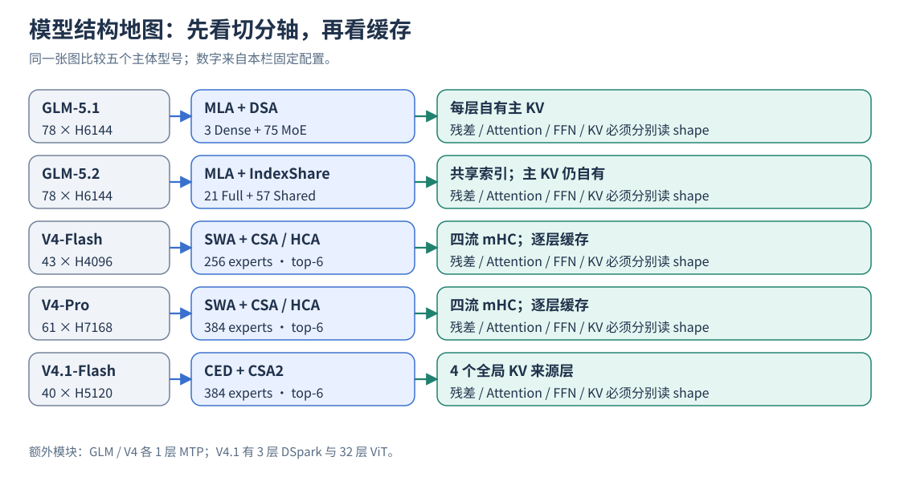
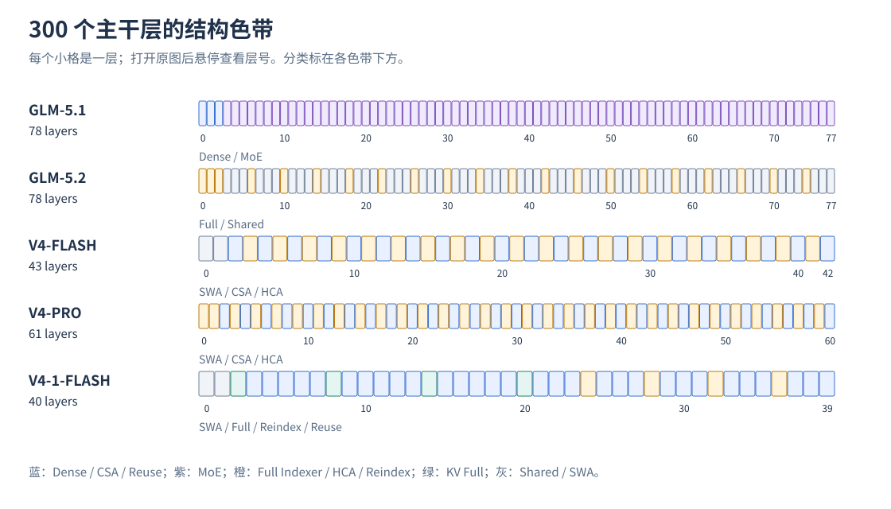

# 🧬 模型结构：从官方配置读到每层 Shape

本栏是模型结构参考，与 [LLM 模型家族导读](../ml/llm/index.md)互补。每篇按 **checkpoint → 全局维度 → 逐层分工 → 模块权重与激活 → KV Cache → 并行部署边界**展开。

数字以官方配置和参考代码为依据，shape 计算是据此作出的推导，不是设备实测。

<figure class="model-figure" markdown="1">

<figcaption markdown="span">图：先分清模型深度、计算宽度与缓存所有权。点击图可打开原始矢量图。</figcaption>

</figure>

## 🗺️ 型号与阅读入口

还不熟悉 SWA、CSA、HCA 或 Indexer 的分工时，先读[压缩注意力与 Indexer](compressed-attention.md)，再对照下面的型号配置。

| 模型 | 主干层数 | 隐藏宽度 H | 主注意力 Q 头数 × 每头宽度 | 路由专家 / 每 Token 选中 | 结构入口 |
| --- | ---: | ---: | --- | --- | --- |
| GLM-5.1 | 78 | 6144 | 64 × 256 | 256 / 8 | [MLA、DSA、Dense → MoE](glm-5-1.md) |
| GLM-5.2 | 78 | 6144 | 64 × 256 | 256 / 8 | [IndexShare 与跨层 Top-k 复用](glm-5-2.md) |
| DeepSeek-V4-Flash | 43 | 4096 | 64 × 512 | 256 / 6 | [Flash / Pro 对照](deepseek-v4.md) |
| DeepSeek-V4-Pro | 61 | 7168 | 128 × 512 | 384 / 6 | [Flash / Pro 对照](deepseek-v4.md) |
| DeepSeek-V4.1-Flash | 40，另有 32 层 ViT | 5120 | 64 × 512 | 384 / 6 | [CED、CSA2、Engram、视觉与 DSpark](deepseek-v4-1.md) |

GLM 的主注意力 Q/K 头宽为 `qk_nope_head_dim + qk_rope_head_dim = 192 + 64`，不是直接采用 JSON 中的 `head_dim`。

所有表先按未切分的逻辑模型解释；量化存储、TP、EP 和运行时融合后的物理 shape 另行标注。先阅读[统一 Shape 约定](shape-conventions.md)。

## 📌 版本与证据

核对日期：**2026-11-24**。以下是本栏使用的官方仓库快照，不将不断变化的 `main` 当成稳定规格：

| 官方仓库 | 固定 revision | 配置快照 |
| --- | --- | --- |
| `zai-org/GLM-5.1` | `26e1bd6e011f` | [JSON](../../assets/model-specs/glm-5-1.config.json) |
| `zai-org/GLM-5.2` | `cf457fa734ab` | [JSON](../../assets/model-specs/glm-5-2.config.json) |
| `deepseek-ai/DeepSeek-V4-Flash` | `60d8d70770c6` | [JSON](../../assets/model-specs/deepseek-v4-flash.config.json) |
| `deepseek-ai/DeepSeek-V4-Pro` | `b5968e9190ef` | [JSON](../../assets/model-specs/deepseek-v4-pro.config.json) |
| `deepseek-ai/DeepSeek-V4.1-Flash` | `314113f8a7da` | [JSON](../../assets/model-specs/deepseek-v4-1-flash.config.json) |
| `deepseek-ai/DeepSeek-V4.1-Flash-1017` | `08c8657f0229` | [JSON](../../assets/model-specs/deepseek-v4-1-flash-1017.config.json) |

完整 revision、配置 SHA-256 与官方实现链接保存在[来源清单](../../assets/model-specs/sources.json)。配置快照分别保留上游 [GLM MIT 许可](../../assets/model-specs/glm.LICENSE.txt)和 [DeepSeek MIT 许可](../../assets/model-specs/deepseek.LICENSE.txt)。

V4.1 Flash 与 1017 在本次快照中的配置相同，这不表示权重、后训练结果或行为相同。

这里把“DSV4.1”落实为已核实的 **V4.1-Flash / Flash-1017**。本次未取得 V4.1-Pro 的官方结构配置，因此不为它填入推测层数。

`deepseek-v4-pro` 等 API 名称与一个具体开源 checkpoint 也不是同一种身份；结构分析应绑定上表仓库与 revision。

[DeepSeek 官方模型目录](https://huggingface.co/deepseek-ai/models)可用于核对名称。

## 🔎 怎样查某一层

<figure class="model-figure" markdown="1">

<figcaption markdown="span">图：一个小格对应一层；各行分类不同，图例与行标签一起阅读。</figcaption>

</figure>

模型页底部有可展开的完整主干层表，**层号从 0 开始**。GLM 的 Dense/MoE、IndexShare，V4 的压缩比例和 Hash-MoE，V4.1 的 KV/Indexer 所有权都逐层列出。

重复层的模块 shape 由正文中的公共模块表定义；MTP、视觉层和 Engram 单独列出，避免把它们误加进主干层数。

逐层表由配置快照生成，可用 `python scripts/model_shapes.py --check` 在仓库根目录复核；更新配置后用 `--write` 重建，再检查代码与文档解释是否仍然适用。

该脚本只做 shape 与层表计算，不下载或加载模型权重。

将结构映射到设备时，继续阅读[TP / PP / DP / EP / CP](../ml/llm/inference/parallelism.md)、[逐层推理与传输](../ml/llm/inference/layerwise-inference.md)和[设备提交搬运任务](../infra/device-initiated-transfer.md)。
